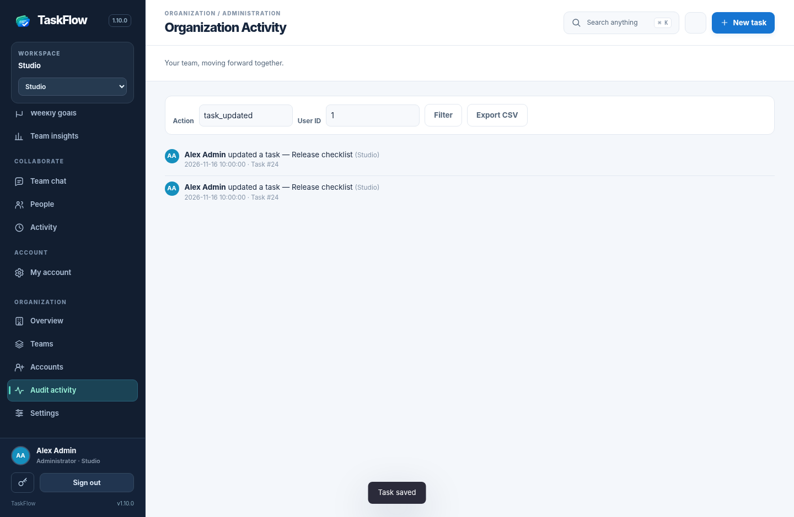

# TaskFlow

**A focused workspace for teams that want to get things done.**

TaskFlow is a lightweight, self-hosted task and project management application built with PHP and MySQL. Plan your week, organize a team, track deadlines, and collaborate securely — on infrastructure you control.


<sub>Screenshot contains sample data. TaskFlow does not require a JavaScript build step or third-party hosted UI libraries.</sub>

## What you can do

| Stay organized | Work together | Stay in control |
| --- | --- | --- |
| Tasks, subtasks, team lists and starred tasks | Comments, @mentions, watched tasks, chat and direct messages | Administrator / manager / member permissions |
| **Calendar, project timeline**, personal work queue, time reports and workload planning | Notifications and due-date reminders | Optional authenticator MFA and recovery codes |
| Kanban board and bulk updates | Dependencies, activity and task search | Secure sessions and sign-out of other devices |
| **Reusable task templates, milestones and project portfolio** | Team goals, weekly timesheets, review approvals and CSV exports | First-run organization setup wizard |
| **Weekly recurring tasks**, estimates, worklogs and live timers | Checklists, priority and tags | Organization data in your own MySQL database |

### New in 1.10.0

- **Private task attachments:** attach PDF, images, text and Office documents to tasks. Each download checks current team access; files are never placed in public asset directories. An administrator must configure a private filesystem path to enable uploads.
- **Flexible recurring tasks:** repeat daily, weekly, every two weeks or monthly on completion. Monthly schedules preserve the original day-of-month where possible, and every occurrence remains idempotent.
- **Audit and activity tools:** filter activity by action or user, browse older entries without unbounded queries and export an administrator/manager-authorized, spreadsheet-safe CSV snapshot.
- **Security and operations:** 8 MiB files, 15 per task, server-side MIME checks, database-enforced file keys, and a dry-run private-file orphan cleaner.

| Private task files | Activity history |
| --- | --- |
|  |  |

[Release 1.10.0 details](docs/RELEASE-1.10.0.md) · [Complete feature guide](docs/FEATURES.md)

## Installation

**You need:** PHP 8.2+ (`pdo_mysql`, `mbstring`, `openssl`, `sodium`, `fileinfo`), MySQL 8+, and an HTTPS-enabled Apache or Nginx host. See [full deployment requirements](docs/DEPLOYMENT.md) and [Nginx configuration](docs/nginx-example.conf).

1. Create an **empty** MySQL database and a dedicated database account.
2. Upload the application files to your PHP host. Keep the private folders inaccessible over HTTP, and allow PHP temporary write access to `config/` during installation.
3. On the server, generate your private setup key:
   ```bash
   php bin/setup-key.php
   ```
4. Open `https://your-domain.example/install/`. The wizard checks requirements, connects the database, creates your organization, and registers the first administrator.
5. Apply least-privilege database access and restrictive configuration-file permissions; enable MFA for administrator accounts. Keep the generated installation lock in place.

There is **no default administrator password or open signup endpoint**. Installations use one organization per database; this is not a shared-database multi-tenant platform.

### Run locally

```bash
php bin/setup-key.php
php -S 127.0.0.1:8080 -t .
```

Open `http://localhost:8080/install/`. Plain HTTP is intended only for localhost development.

### Upgrade to TaskFlow 1.10.0

Back up and restore-test the existing database, attachments (if configured), private configuration, and application key. When upgrading from **1.9.0**, apply `docs/migrations/1.10.0.sql` **once** in staging before deploying this source. From older versions, apply every missing migration in order. Preserve `config/config.local.php`, `config/.installed` and the existing encryption key; never rerun the installer over real data. [Full upgrade guide](docs/UPGRADE.md).

**Enabling private task files:** create a writable, restricted directory **outside** the web document root, for example `/var/lib/taskflow-files`, with permissions `0700` and ownership assigned to the PHP worker. Set `TASKFLOW_ATTACHMENTS_DIR` to its absolute path in the PHP-FPM/Apache worker environment and restart PHP. Without this variable, file uploads and downloads intentionally remain disabled; other TaskFlow features continue working. Set `upload_max_filesize` and `post_max_size` high enough for an 8 MiB file and multipart overhead. Files are never served by Nginx/Apache directly; both the PHP download endpoint and the server's private directory permissions must remain protected.

## How it's built

TaskFlow runs on PHP and MySQL, with server-side permission checks and database transactions for multi-record operations. The interface is native JavaScript and CSS, without a Node runtime, external CDN dependencies or a frontend compilation step.

Optional scheduled jobs:

```bash
php bin/due-reminders.php   # daily notifications
php bin/process-mail.php    # queued mail delivery, when enabled
php bin/maintenance.php     # scheduled housekeeping
php bin/attachments-gc.php # preview orphaned private files; add --delete to remove old ones
```

**Limitations:** Files require explicitly configured private local storage; shared/multi-node hosting requires a shared trusted filesystem and separate backup procedure. Deleting tasks can leave files for the CLI orphan cleaner; run `php bin/attachments-gc.php --delete` only after a dry run. There is no antivirus integration or total organization-level storage quota. One organization per installation, no automatic horizontal scaling, and separate database/session configuration required for multiple web nodes. Timeline fetches 100 tasks per page and up to 100 milestone markers per filter, within a 4/8/12-week window. Calendar downloads are session-authenticated snapshots, capped at 500 tasks and 200 milestones per export. Portfolio returns 25 task lists per page and manager/admin CSV export is capped at 500 lists. Personal saved searches are capped at 20 per user per team. Project updates load 20 history entries per request; task watching does not change who can edit a task. Milestones return up to 20 cards per page and 40 linked tasks per detail page, with limits on pagination depth. The calendar deliberately returns no more than 400 due tasks per six-week view. Time reports are capped at 31 days and paginate results. Weekly timesheets show 100 task/member groups and exports accept up to 5,000 entries. Manager approval queues display up to 100 submissions per week. Workload pages return at most 100 active team members per page and consider at most 52 weeks before/after the current UTC week. Worklogs and timers are not verified billing data.

## Development and verification

```bash
find . -type f -name '*.php' -print0 | xargs -0 -n1 php -l
node --check assets/js/app.js
node --check install/assets/installer.js
php tests/security_static.php
php tests/feature_unit.php
php tests/workflow_unit.php
php tests/recurrence_unit.php
php tests/worklog_unit.php
php tests/timer_unit.php
php tests/reviews_unit.php
php tests/workload_unit.php
php tests/milestones_unit.php
php tests/portfolio_unit.php
php tests/saved_views_unit.php
php tests/project_updates_unit.php
php tests/timeline_unit.php
php tests/release_110_unit.php  # recurrence, file policy, activity export validation
python3 tests/feature_views_ui_smoke.py  # optional: Playwright + Chromium
python3 tests/worklog_ui_smoke.py  # optional: manual report and starred tasks
python3 tests/timer_ui_smoke.py  # optional: timers and weekly timesheet
python3 tests/approvals_ui_smoke.py  # optional: timesheet review interactions
python3 tests/workload_ui_smoke.py  # optional: estimates and capacity interactions
python3 tests/milestones_ui_smoke.py  # optional: milestone actions and mobile layout
python3 tests/portfolio_saved_ui_smoke.py  # optional: portfolio and saved searches
python3 tests/project_updates_ui_smoke.py  # optional: update feed and task watchers
python3 tests/timeline_ui_smoke.py  # optional: timeline, calendar link and mobile layout
python3 tests/release_110_ui_smoke.py  # optional: files, recurrence and audit UI
```

GitHub Actions runs static checks and a separate ephemeral MySQL 8 integration workflow. **Automated checks are not an independent security audit.** Exercise real MySQL endpoints, restore backups, conduct security testing, and measure performance before an important public deployment.

## Documentation

- [Features](docs/FEATURES.md) · [Release notes](docs/RELEASE-1.10.0.md) · [Change history](CHANGELOG.md)
- [Deployment](docs/DEPLOYMENT.md) · [Upgrade](docs/UPGRADE.md) · [Administrator MFA](docs/ADMIN-MFA.md)
- [Security policy](SECURITY.md) · [Testing](docs/TEST-RESULTS.md) · [GitHub publishing](docs/GITHUB-PUBLISH.md)

## Repository structure

`api/` endpoints · `assets/` UI and brand · `bin/` CLI jobs · `config/` configuration · `docs/` guides · `includes/` security and database helpers · `install/` setup wizard · `tests/` checks

## License

No open-source distribution license has been selected. Review licensing before accepting contributions or advertising public reuse rights.
