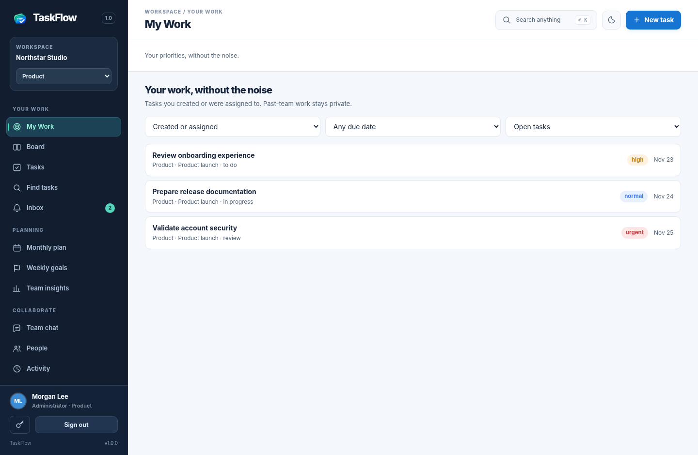

# TaskFlow

**A calmer way to get work done.** TaskFlow is a lightweight, self-hosted, organization-first workspace for teams, projects and everyday execution.


[](#quality--release-status) [](VERSION) [](#run-taskflow)

> **Public baseline: TaskFlow v1.0.0** — the complete workspace consolidated into a single first release, with no "NEXT" product suffix or inherited preview branding. The application includes a newly designed interface and installation experience while retaining existing features and data structures.



*Interface preview uses synthetic test data; it is not a screenshot of a live organization.*

## Everything in one workspace

| Organize work | Work together | Stay secure |
| --- | --- | --- |
| Personal My Work queue, tasks and Kanban board | Team chat, direct messages, comments and @mentions | Role-based access (Administrator / Manager / Member) |
| Weekly and monthly planning, team insights | Due-date reminders and notification inbox | Optional TOTP MFA and one-time recovery codes |
| Task dependencies, checklists, tags and duplicates | Team-scoped task search and CSV exports | Session revocation, CSRF protection, secure cookies |
| Atomic bulk updates (up to 50 tasks) | Activity history and notification preferences | One-time setup key; no default admin login |

### A refreshed 1.0 experience

- Focused workspace sidebar, accessible icon navigation and compact toolbar.
- Light and dark appearances; preference stored locally in your browser.
- Quick **New task** action and keyboard search with `Ctrl/Cmd + K`.
- Rebuilt sign-in screens and four-step organization setup.
- Mobile-friendly board, tables, dialogs and navigation; reduced-motion support.
- No hosted fonts, analytics scripts, external JavaScript UI frameworks or frontend build step.

## Run TaskFlow

**Requirements:** PHP 8.2+ with `pdo_mysql`, `mbstring`, `sodium`, `openssl` and session support; MySQL 8.0+; HTTPS for public installations. Apache 2.4+ or Nginx with the supplied access-deny rules.

### Fresh installation

1. Provision an **empty** MySQL database and a dedicated database user with temporary schema-creation privileges.
2. Upload the `TaskFlow/` files to your PHP hosting environment. Use HTTPS and temporarily grant the PHP worker write access to `config/`. Protect private folders from static web access.
3. On the server, generate the private one-time setup key:
   ```bash
   php bin/setup-key.php
   ```
4. Open `https://your-domain.example/install/`, follow the four screens (System, Database, Organization, Security), and create the first administrator with a unique passphrase.
5. After installation, the setup key is deleted, an installation lock is created, and private configuration is written to the ignored `config/config.local.php` file. Review file permissions, database privileges, backup and TLS configuration.
6. Sign in, enable MFA for administrators, and create teams and accounts.

**No hardcoded default administrator, password or public registration endpoint exists.** The installer refuses to claim a database containing existing users. Do not delete the installation lock to recover an existing installation.

### Local development (localhost only)

```bash
php bin/setup-key.php
php -S 127.0.0.1:8080 -t .
```

Open `http://localhost:8080/install/`. Plain HTTP is **only** allowed for explicit localhost development; do not make a development instance public.

### Existing preview installations

A **version reset is not a database rollback**. Preserve your database, secret key, account records and installation lock. Back up everything and follow [Upgrade from previews](docs/UPGRADE.md). Old preview SQL patches are retained under `docs/migrations/` **only** to support existing installations; new organizations use `schema.sql` through the setup wizard.

## Operations and scaling

TaskFlow runs directly on PHP and MySQL. Notifications can be generated with scheduled CLI jobs instead of a continuously running worker:

```bash
php bin/due-reminders.php     # schedule once per day via server cron
php bin/process-mail.php      # optional mail queue consumer
php bin/maintenance.php       # periodic retention housekeeping
```

Email queue use is optional and must be configured consciously. See [deployment and hardening](docs/DEPLOYMENT.md) for supported environment variables, web server deny rules, backups, session storage, mail and scaling notes.

**Current hosting model:** one organization per installation and database. This does *not* provide tenant-isolated multitenancy or automated scaling. Large data sets and multi-node deployments need database profiling, shared sessions and production load tests.

## Quality & release status

```bash
find . -type f -name '*.php' -print0 | xargs -0 -n1 php -l
node --check assets/js/app.js
node --check install/assets/installer.js
php tests/security_static.php
php tests/feature_unit.php
php tests/workflow_unit.php
# Optional when Playwright + Chromium are available:
python3 tests/workspace_ui_smoke.py
python3 tests/workflow_ui_smoke.py
python3 tests/design_ui_smoke.py
python3 tests/installer_ui_smoke.py
```

GitHub Actions includes code checks and a separate disposable MySQL 8 integration test. **v1.0.0 is a release candidate:** a passing syntax check or mocked browser run is not proof of production security. Live MySQL endpoint/installer integration, independent application security review, backup/restore drills and performance/load tests are still required before a high-trust public launch.

## Documentation

- [1.0.0 release notes](docs/RELEASE-1.0.0.md)
- [All core features](docs/FEATURES.md)
- [First-run and operations guide](docs/DEPLOYMENT.md)
- [Upgrading existing previews](docs/UPGRADE.md)
- [MFA administration](docs/ADMIN-MFA.md)
- [Security policy and remaining risks](SECURITY.md)
- [GitHub publishing checklist](docs/GITHUB-PUBLISH.md)
- [Verification results](docs/TEST-RESULTS.md)

## Source layout

`api/` JSON endpoints · `includes/` auth/DB/security helpers · `assets/` interface and brand assets · `install/` four-step one-time setup · `bin/` CLI jobs · `docs/` guidance/migrations · `tests/` automated checks · `.github/` CI.

## License / publishing

No distribution license has been selected. **Do not represent this project as open-source until you intentionally choose and add a LICENSE.** The source is structured for GitHub, but no remote repository has been created or pushed automatically.
