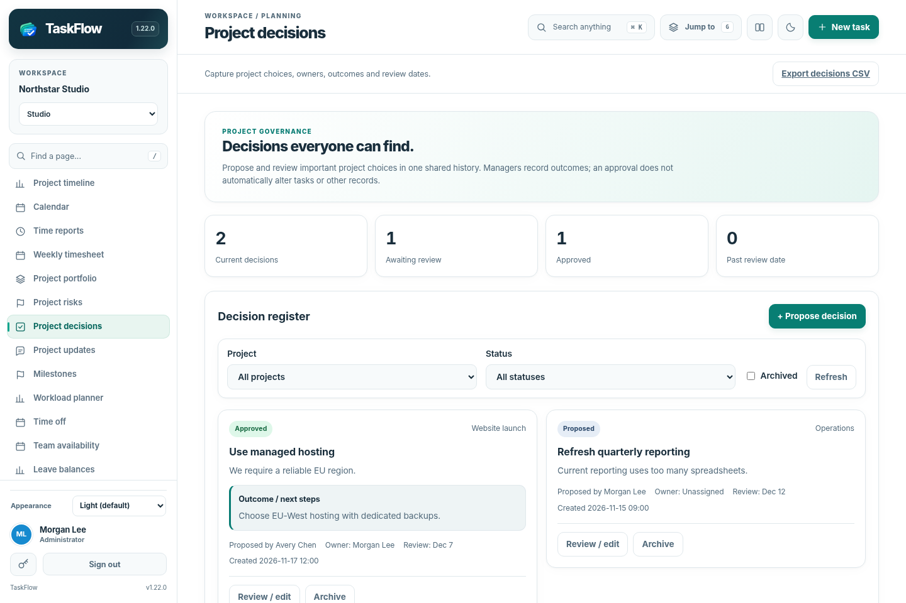
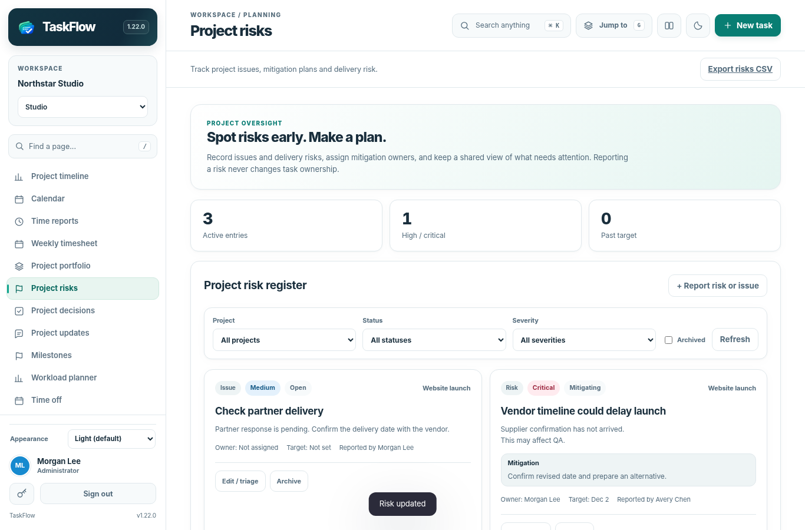
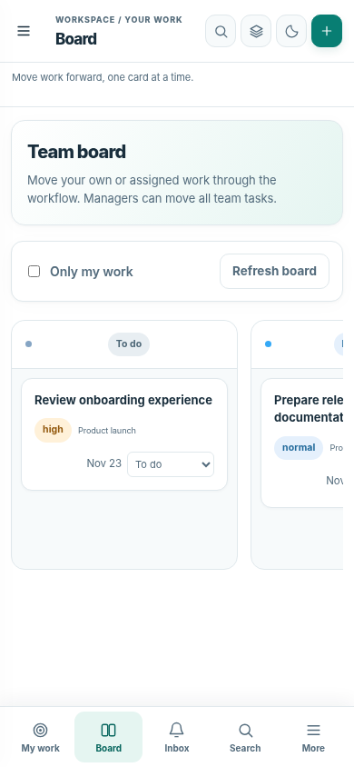

# TaskFlow

**A focused workspace for teams that want to get things done.**

TaskFlow is a lightweight, self-hosted task and project management application built with PHP and MySQL. Plan your week, organize a team, track deadlines, and collaborate securely — on infrastructure you control.


<sub>Screenshot contains sample data. TaskFlow does not require a JavaScript build step or third-party hosted UI libraries.</sub>

## What you can do

| Stay organized | Work together | Stay in control |
| --- | --- | --- |
| Tasks, subtasks, team lists and starred tasks | Comments, @mentions, watched tasks, chat and direct messages | Administrator / manager / member permissions |
| **Calendar, project timeline**, personal work queue, leave approvals and capacity-aware workload | Notifications and due-date reminders | Optional authenticator MFA and recovery codes |
| Kanban board and bulk updates | Dependencies, activity and task search | Secure sessions and sign-out of other devices |
| **Reusable task templates, milestones, project portfolio and decisions** | Team goals, weekly timesheets, review approvals and CSV exports | First-run organization setup wizard |
| **Flexible recurring tasks**, estimates, worklogs and live timers | Checklists, priority and tags | Organization data in your own MySQL database |

### New in 1.22.0: five additional appearance themes

**Light is the default** for first-time users and for all screenshots shown in the main GitHub gallery. Saved preferences remain respected. Choose an appearance in the sidebar or on the sign-in screen:

| Light (default) | Dark | System | Ocean | Forest | Lavender | Sunset | Midnight |
| --- | --- | --- | --- | --- | --- | --- | --- |
| White / neutral | Charcoal | Matches device | Coastal blue | Natural green | Soft purple | Warm terracotta | Deep indigo |

- **Five new complete palettes:** Ocean, Forest, Lavender, Sunset and Midnight recolor the workspace, navigation, hero, buttons and sign-in areas while keeping project/task status semantics intact.
- **Instant theme switching:** all eight options work before or after sign-in; your choice is stored only in your browser. System continues to follow OS appearance changes.
- **Contrast checks:** every new palette is tested against 8 existing screens and the sign-in form. No database migration, external UI framework or third-party theme service.
- **GitHub screenshots default to Light:** all inline screenshots below use the bright, white-background appearance; dark and custom-color examples are optional links rather than GitHub's default preview.

| My Work · Light | Board · Light |
| --- | --- |
|  |  |

| Project decisions · Light | Project risks · Light |
| --- | --- |
|  |  |

**Optional color theme examples:** [View all themes together](docs/screenshots/theme-collection.png) · [Ocean](docs/screenshots/theme-ocean.png) · [Forest](docs/screenshots/theme-forest.png) · [Lavender](docs/screenshots/theme-lavender.png) · [Sunset](docs/screenshots/theme-sunset.png) · [Midnight](docs/screenshots/theme-midnight.png).

[Release 1.22.0 details](docs/RELEASE-1.22.0.md) · [Upgrade guide](docs/UPGRADE.md) · [Feature guide](docs/FEATURES.md)

### New in 1.21.0: a readable interface in every theme

This release fixes the dark-mode text and panel contrast regressions reported after the v1.20 redesign. It works throughout the existing TaskFlow interface **without a database migration or frontend framework**.

- **True theme-aware text and surfaces:** decision outcomes, risk badges, milestone states, announcements, leave records, inbox metadata, modals, forms, inputs, status labels and project cards use consistent semantic colors. Previously, some dark-mode panels displayed nearly white text on white backgrounds or dark gray text on dark cards.
- **Appearance choice anywhere:** select **Light**, **Dark** or **Use device setting** in the sidebar, or use the appearance buttons on the sign-in screen. The topbar sun/moon button remains a one-click toggle; the chosen preference is saved in your browser.
- **Device-theme support:** the System option responds when your OS switches between light and dark. A small, same-origin boot script applies the stored preference before the main styles load, reducing theme flashing on page reload.
- **Polished visual details:** dark dialogs, profile initials, highlighted inbox entries, input placeholders, sidebar labels, status chips and responsive cards have clearer contrast and focus states.
- **Regression coverage:** real Chromium checks test 66 key text/background combinations across eight screens in both themes, plus login readability, theme switching and mobile dark mode. The test covers selected surfaces, not every possible UI state or a full accessibility certification.

**Dark-mode references (optional):** [Decisions](docs/screenshots/dark-decisions-accessible.png) · [Risks](docs/screenshots/dark-risks-accessible.png) · [Sign-in](docs/screenshots/login-dark-accessible.png) · [Mobile](docs/screenshots/decisions-mobile-dark-accessible.png). The main gallery above intentionally remains light.

[Release 1.21.0 details](docs/RELEASE-1.21.0.md) · [Upgrade guide](docs/UPGRADE.md) · [Feature guide](docs/FEATURES.md)

### A better workspace in 1.20.0

TaskFlow now has a cohesive, accessible interface across daily work, project oversight and organization administration. Everything stays self-hosted and uses the existing account roles.

- **Focus-first My Work:** an updated personal dashboard with quick filters for overdue work, tasks due today, this week and starred items. The filters call the existing permission-checked API.
- **Find a page:** filter navigation by name directly in the sidebar, and collapse sections to keep a large workspace manageable. The sidebar retains every feature from earlier versions.
- **Page switcher:** use **Jump to** or **Ctrl/Cmd + Shift + K** to find an authorized page. The existing **Ctrl/Cmd + K** task search is unchanged. Press **/** outside a form to focus the sidebar filter.
- **Comfortable and compact layouts:** switch density without changing task content; the preference is stored only in your browser.
- **Mobile bottom navigation:** one-touch shortcuts to My Work, Board, Inbox, Search and all remaining pages through More.
- **App-wide visual refinement:** polished task lists, Kanban lanes, forms, status labels, reports, dialogs, sign-in, responsive layouts and a consistent dark theme. The first-run organization installer matches the new palette.

| Light dashboard | Mobile Light board |
| --- | --- |
|  |  |

Optional UI details: [Page switcher](docs/screenshots/page-switcher.png) · [Dark board](docs/screenshots/board-dark.png).

<sub>Previews use synthetic data. The UI redesign does not change server-side authorization, passwords, roles, task data or the MySQL schema. No new JavaScript framework, frontend build step or external CDN is needed.</sub>

[Release 1.20.0 details](docs/RELEASE-1.20.0.md) · [Previous release 1.19.0](docs/RELEASE-1.19.0.md) · [Complete feature guide](docs/FEATURES.md)

## Installation

**You need:** PHP 8.2+ (`pdo_mysql`, `mbstring`, `openssl`, `sodium`, `fileinfo`), MySQL 8+, and an HTTPS-enabled Apache or Nginx host. See [full deployment requirements](docs/DEPLOYMENT.md) and [Nginx configuration](docs/nginx-example.conf).

1. Create an **empty** MySQL database and a dedicated database account.
2. Upload the application files to your PHP host. Keep the private folders inaccessible over HTTP, and allow PHP temporary write access to `config/` during installation.
3. On the server, generate your private setup key:
   ```bash
   php bin/setup-key.php
   ```
4. Open `https://your-domain.example/install/`. The wizard checks requirements, connects the database, creates your organization, and registers the first administrator.
5. Apply least-privilege database access and restrictive configuration-file permissions; enable MFA for administrator accounts. Keep the generated installation lock in place.

Invitation links may be sent directly over configured SMTP or copied privately. Without SMTP, only manual delivery is available. Password recovery requires working SMTP.

There is **no default administrator password or open signup endpoint**. An administrator can create single-use invitations from Accounts after setup. Installations use one organization per database; this is not a shared-database multi-tenant platform.

### Run locally

```bash
php bin/setup-key.php
php -S 127.0.0.1:8080 -t .
```

Open `http://localhost:8080/install/`. Plain HTTP is intended only for localhost development.

### Upgrade to TaskFlow 1.22.0

Back up and restore-test your installation, private configuration and MySQL database. Upgrading **from v1.21.0 to v1.22.0 needs no SQL migration**. Deploy the updated CSS, JavaScript and PHP files, preserving `config/config.local.php`, `config/.installed`, the application encryption key and private attachments. Clear cached assets, confirm `theme-palettes.css` and `theme-boot.js` return HTTP 200, and verify each appearance on login, tasks and mobile. Existing saved Light/Dark/System preferences remain supported; new accounts start with Light. From older versions, apply all missing migrations **through 1.19.0** in order. Never rerun the installer over live data. [Detailed upgrade guide](docs/UPGRADE.md).

**Enabling private task files:** create a writable, restricted directory **outside** the web document root, for example `/var/lib/taskflow-files`, with permissions `0700` and ownership assigned to the PHP worker. Set `TASKFLOW_ATTACHMENTS_DIR` to its absolute path in the PHP-FPM/Apache worker environment and restart PHP. Without this variable, file uploads and downloads intentionally remain disabled; other TaskFlow features continue working. Set `upload_max_filesize` and `post_max_size` high enough for an 8 MiB file and multipart overhead. Files are never served by Nginx/Apache directly; both the PHP download endpoint and the server's private directory permissions must remain protected.

## How it's built

TaskFlow runs on PHP and MySQL, with server-side permission checks and database transactions for multi-record operations. The interface is native JavaScript and CSS, without a Node runtime, external CDN dependencies or a frontend compilation step.

Optional scheduled jobs:

```bash
php bin/due-reminders.php   # daily task notifications
php bin/risk-reminders.php  # daily risk review notifications (optional)
php bin/process-mail.php    # queued mail delivery, when enabled
php bin/maintenance.php     # scheduled housekeeping
php bin/attachments-gc.php # preview orphaned private files; add --delete to remove old ones
```

**Limitations:** Files require explicitly configured private local storage; shared/multi-node hosting requires a shared trusted filesystem and separate backup procedure. Deleting tasks can leave files for the CLI orphan cleaner; run `php bin/attachments-gc.php --delete` only after a dry run. There is no antivirus integration or total organization-level storage quota. Coverage acknowledgement is an advisory handoff only: no tasks, memberships, roles or approvals are changed. ICS exports are authenticated snapshots, not continuously synchronized subscriptions, and recipients can share downloaded files outside TaskFlow. Half-day entries are date-only, labeled as partial-day and marked transparent. Leave-balance CSV is restricted to 500 active members per download. Leave capacity is a weekly planning approximation using equal shares of each configured workday. Holidays are one-off UTC dates, not automatic regional holiday feeds. The system is not payroll or a statutory leave entitlement engine. One organization per installation, no automatic horizontal scaling, and separate database/session configuration required for multiple web nodes. Timeline fetches 100 tasks per page and up to 100 milestone markers per filter, within a 4/8/12-week window. Calendar downloads are session-authenticated snapshots, capped at 500 tasks and 200 milestones per export. Portfolio returns 25 task lists per page and manager/admin CSV export is capped at 500 lists. Personal saved searches are capped at 20 per user per team. Project updates load 20 history entries per request; task watching does not change who can edit a task. Milestones return up to 20 cards per page and 40 linked tasks per detail page, with limits on pagination depth. The calendar deliberately returns no more than 400 due tasks per six-week view. Time reports are capped at 31 days and paginate results. Weekly timesheets show 100 task/member groups and exports accept up to 5,000 entries. Manager approval queues display up to 100 submissions per week. Workload pages return at most 100 active team members per page and consider at most 52 weeks before/after the current UTC week. Worklogs and timers are not verified billing data.

## Development and verification

```bash
find . -type f -name '*.php' -print0 | xargs -0 -n1 php -l
node --check assets/js/app.js
node --check assets/js/ui-enhancements.js
node --check assets/js/theme-boot.js
# Theme color variables: assets/css/theme-palettes.css
node --check install/assets/installer.js
php tests/security_static.php
php tests/feature_unit.php
php tests/workflow_unit.php
php tests/recurrence_unit.php
php tests/worklog_unit.php
php tests/timer_unit.php
php tests/reviews_unit.php
php tests/workload_unit.php
php tests/time_off_unit.php
php tests/scheduling_unit.php
php tests/leave_balances_unit.php
php tests/coverage_unit.php
php tests/availability_export_unit.php
php tests/milestones_unit.php
php tests/portfolio_unit.php
php tests/saved_views_unit.php
php tests/project_updates_unit.php
php tests/timeline_unit.php
php tests/release_110_unit.php  # recurrence, file policy, activity export validation
php tests/invitations_unit.php   # invite token, role and URL validation
php tests/recovery_unit.php      # recovery token, canonical link and rate policy
php tests/secure_mail_unit.php   # encrypted bearer-link mail payloads
php tests/project_risks_unit.php  # validation and risk status policy
python3 tests/design_ui_smoke.py
python3 tests/theme_contrast_ui_smoke.py  # Chromium + Playwright
python3 tests/theme_palettes_ui_smoke.py  # five additional palettes
python3 tests/readme_screenshots_unit.py  # enforce Light README screenshots  # desktop/mobile shell, navigation, command switcher, themes
python3 tests/installer_ui_smoke.py  # branded four-step setup flow
python3 tests/project_risks_ui_smoke.py  # optional: project risks, manager controls and portfolio
python3 tests/coverage_ui_smoke.py  # optional: coverage requests and export links
python3 tests/feature_views_ui_smoke.py  # optional: Playwright + Chromium
python3 tests/worklog_ui_smoke.py  # optional: manual report and starred tasks
python3 tests/timer_ui_smoke.py  # optional: timers and weekly timesheet
python3 tests/approvals_ui_smoke.py  # optional: timesheet review interactions
python3 tests/workload_ui_smoke.py  # optional: estimates and capacity interactions
python3 tests/scheduling_ui_smoke.py  # optional: holidays, half-day leave, custom schedules
python3 tests/time_off_ui_smoke.py  # optional: time-off requests, manager approvals and mobile layout
python3 tests/milestones_ui_smoke.py  # optional: milestone actions and mobile layout
python3 tests/portfolio_saved_ui_smoke.py  # optional: portfolio and saved searches
python3 tests/project_updates_ui_smoke.py  # optional: update feed and task watchers
python3 tests/timeline_ui_smoke.py  # optional: timeline, calendar link and mobile layout
python3 tests/release_110_ui_smoke.py  # optional: files, recurrence and audit UI
python3 tests/invitations_ui_smoke.py  # optional: administrator and recipient screens
python3 tests/recovery_ui_smoke.py  # optional: public and reset forms, mobile layout
```

GitHub Actions runs static checks and a separate ephemeral MySQL 8 integration workflow. **Automated checks are not an independent security audit.** Exercise real MySQL endpoints, restore backups, conduct security testing, and measure performance before an important public deployment.

## Documentation

- [Features](docs/FEATURES.md) · [Release notes](docs/RELEASE-1.22.0.md) · [Change history](CHANGELOG.md)
- [Deployment](docs/DEPLOYMENT.md) · [Upgrade](docs/UPGRADE.md) · [Administrator MFA](docs/ADMIN-MFA.md)
- [Security policy](SECURITY.md) · [Testing](docs/TEST-RESULTS.md) · [GitHub publishing](docs/GITHUB-PUBLISH.md)

## Repository structure

`api/` endpoints · `assets/` UI and brand · `bin/` CLI jobs · `config/` configuration · `docs/` guides · `includes/` security and database helpers · `install/` setup wizard · `tests/` checks

## License

No open-source distribution license has been selected. Review licensing before accepting contributions or advertising public reuse rights.
