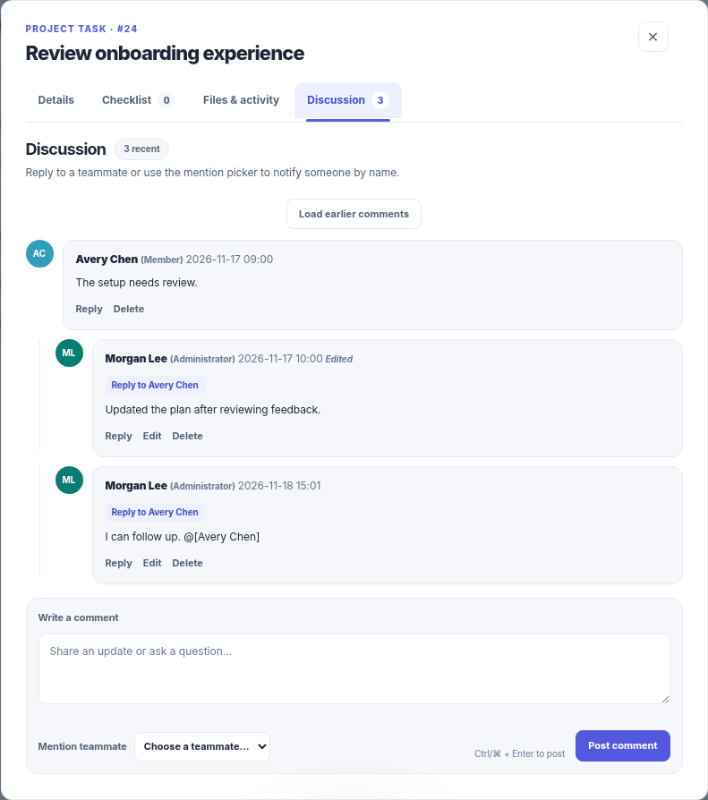
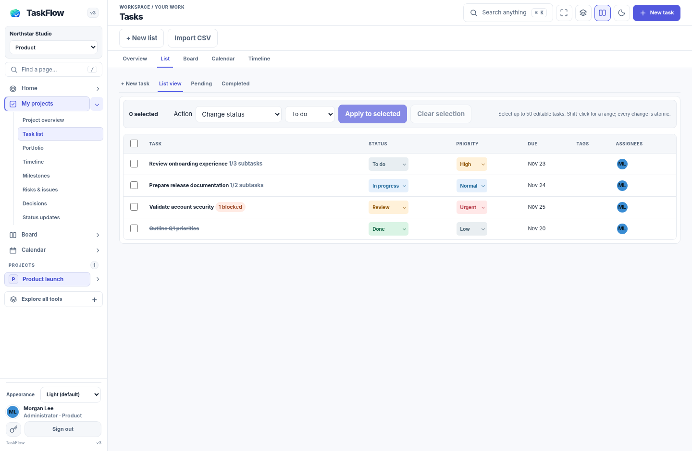
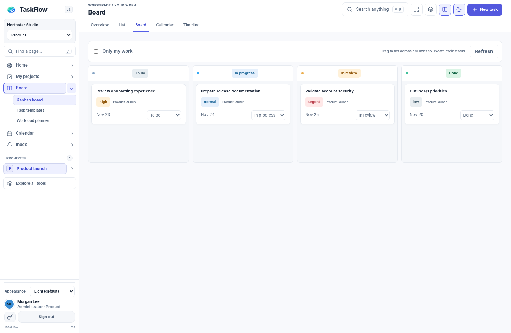
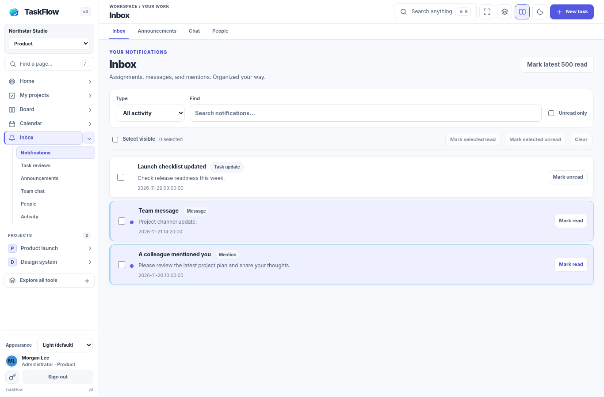
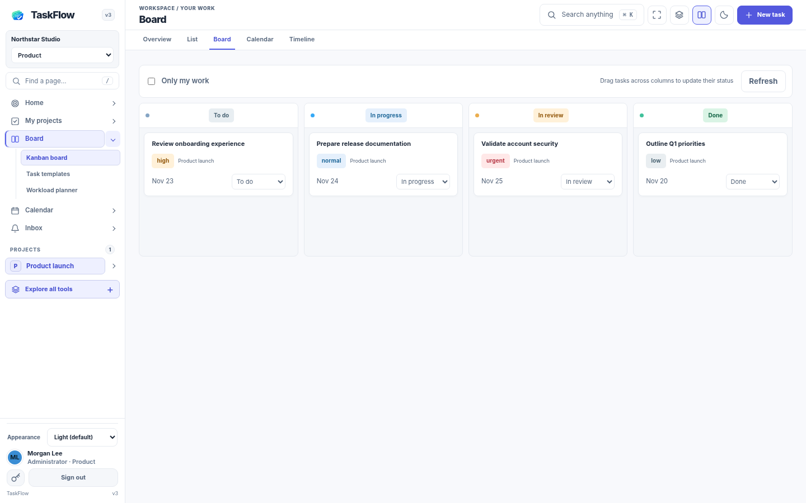

# TaskFlow v3

**A modern, self-hosted workspace for projects, tasks, and teams.** Plan work, manage delivery, and stay aligned in one compact interface, with Light, Charcoal, and Black themes.


**Public-release status:** The feature set is frozen and the source is ready for GitHub review and production-like staging. **Unrestricted public hosting is not yet certified.** Real MySQL 8 integration, HTTPS, backup restoration, ClamAV detection, authenticated cross-team testing, and independent security review are still release gates.

[Installation](#install-taskflow-v3) · [Full feature overview](#what-is-included) · [Deployment guide](docs/DEPLOYMENT.md) · [Staging checklist](docs/STAGING-ACCEPTANCE.md) · [Security policy](SECURITY.md)

### Why TaskFlow?

- **Stay focused:** a compact project rail, task lists, Kanban, calendars, and My Work views.
- **Work together:** team discussions, task reviews, chat, notifications, decisions, and activity history.
- **Keep ownership:** a self-hosted, single-organization PHP/MySQL deployment with an explicit installation and upgrade process.
- **Choose your workspace:** **Light is the default** and GitHub preview screenshots use white backgrounds; Charcoal, Black/OLED, and other color palettes are available.

## Public release readiness

The source archive is for GitHub review and testing. A separate slim deployment ZIP omits test fixtures and screenshots without removing runtime application functionality. Existing installations must follow the documented migration path; do not replace a populated database with `schema.sql`. Production task attachments require configured, monitored ClamAV or uploads intentionally fail closed. No local unit or mocked-browser run is a substitute for real multi-user MySQL staging.

**Current polish:** Keyboard-accessible task and prompt dialogs now trap/restore focus, reject stale task responses, and retain edited form contents on errors. Unexpected successful HTTP responses are not silently accepted, and session expiry cleanly returns users to sign-in. [Release QA details](docs/RELEASE-PUBLIC.md) · [Earlier hardening history](docs/RELEASE-HARDENING-HISTORY.md).

---

## Task reviews: submit, approve, or request changes


**Task Review Queue** adds a structured handoff to the existing Review status. A task creator or assignee can request review with an optional note; active team managers and administrators can **approve** or **request changes** with required feedback. Approving marks the task complete after checking its blockers, including recurring-task completion behavior. Returning it moves the task to In progress, ready for another submission. Reviewers cannot approve their own requests.

- **Personal and team queues:** team managers see pending work and history, while members see only requests they submitted. Search by status, load 25 results at a time, and open the task directly from the queue.
- **Review history:** the task detail panel shows the current decision, requester note, reviewer feedback and the 15 latest decision events.
- **Notifications:** active same-team managers are notified about new requests; the original submitter receives an Inbox notification on a decision.
- **Completion guard:** a pending review cannot be bypassed through Task Details or bulk status updates. Only the manager review endpoint approves completion. Manager self-review is forbidden.
- **Security:** team-scoped reads and writes, CSRF, optimistic version checks, task row locks, a single current request per task, and append-only event history.

[Black / OLED preview](docs/screenshots/v3-task-reviews-black.png) · [Mobile Charcoal preview](docs/screenshots/v3-task-reviews-mobile.png)

**Upgrade from the immediately preceding v3 Discussions source:** Back up and restore-test MySQL 8, then apply **`docs/migrations/v3-task-reviews.sql` exactly once before deploying this source**. This is an additive two-table migration; existing tasks, comments, approvals, and histories are preserved. Fresh installs use the included `schema.sql`. If coming from older v3 code, apply `v3-discussions.sql` first. Keep the public release label **TaskFlow v3** without any internal version suffix. [Upgrade guide](docs/UPGRADE.md).

## Better task discussions and replies

Task discussions now have **threaded replies**, **inline editing for the original author**, and a **Mention teammate** picker. A reply stays visually connected to its parent discussion, and edited messages are labeled. Use **Ctrl/⌘ + Enter** to post. Messages can be up to 3,000 UTF-8 bytes and may mention up to 10 active teammates from the task's team. The picker disambiguates identical display names using an ID-backed token. Mention lookup is capped at 500 active team members; ordinary comments still work in larger teams. New mentions and active reply authors can receive existing TaskFlow notifications, without sending duplicate task-watcher alerts. Managers may moderate (delete) comments but cannot silently edit someone else's words. Posting is limited to 100 comments per author per hour.

Discussion history is **paged**, showing the latest 60 comments initially with **Load earlier comments** for older messages (40 per page), instead of an unbounded task-detail request. All team checks, author-only edits, CSRF protection and optimistic edit versions are enforced on the server; deleted parent comments leave their replies intact.

| Discussions · Light | Discussion · Black / OLED |
| --- | --- |
|  | [Open dark preview](docs/screenshots/v3-discussions-black.png) |

[Mobile discussion preview](docs/screenshots/v3-discussions-mobile.png)

**Upgrade from a v3 build without discussion support:** That earlier update **requires a separate additive MySQL migration**: `docs/migrations/v3-discussions.sql`. Back up and restore-test your database, apply the migration **once** on MySQL 8 staging, then deploy the new files. Existing comments and mentions are preserved. All historical migration filenames and the **TaskFlow v3** public name stay unchanged. See [Upgrade instructions](docs/UPGRADE.md).

## Task details, without endless scrolling

Task details now use **four compact tabs**—**Details**, **Checklist**, **Files & activity**, and **Discussion**—instead of stacking every control into one long editor. Existing field updates, task attachments, dependencies, worklogs, watchers and comments remain available under their respective tabs. Saving a checklist step keeps the Checklist tab open.

Checklist editing is faster and easier to review:

- **Paste multiple steps:** add up to 30 steps at once, one per line, in a single transaction. Each task supports up to 200 checklist steps.
- **Inline editing:** rename or remove a step without leaving task details.
- **Move steps up/down:** reorder with accessible buttons; a stale or incomplete sequence is rejected rather than overwriting someone else's changes.
- **Progress at a glance:** a count and progress bar update as steps are completed. People without task-edit permissions see the same checklist read-only.

[Task Checklist · Light](docs/screenshots/v3-task-checklist-light.png) · [Task Details · Light](docs/screenshots/v3-task-details-light.png) · [Black / OLED](docs/screenshots/v3-task-checklist-black.png) · [Mobile](docs/screenshots/v3-task-checklist-mobile.png)

**Checklist compatibility:** The earlier checklist update reuses existing checklist tables and the task-detail API. It requires **no SQL migration**, new background job or internal version number. Existing task permission checks still apply. The main README screenshots remain Light with white backgrounds; dark screenshots are optional previews.

## Compact daily workspace


The Home screen is a **full-width task queue** rather than a dashboard of duplicate shortcuts. Each row aligns **task, project, status, priority and due date**. Quick filters include **Open tasks** (one-tap reset), Overdue, Today, Next 7 days, and Starred. The loaded-task summary is explicit about its scope, and switching filters ignores stale network responses.

The slimmer sidebar keeps Home, Projects, Board, Calendar and Inbox handy. Teams with more than eight projects can **search or expand the complete project list in place**. Board, List and detail views use tighter spacing, while mobile keeps status and priority visible. **Compact is now the default density** on new browser installations; people who previously selected Comfortable retain their preference.

| Project List · Light | Kanban Board · Light |
| --- | --- |
|  |  |

| Decisions · Light | Risks · Light |
| --- | --- |
|  |  |

### Faster task management

Project List supports **batch changes for up to 50 editable tasks**. Select rows individually, Shift-click to select a range, or choose the entire visible page. The action menu is now grouped into **Progress**, **Schedule**, **Planning**, **Labels**, and (for managers) **People**, so related actions are easier to locate.

Batch actions include **Status**, **Priority**, **Set/Clear start date**, **Set/Clear due date**, **Set/Clear estimated effort (minutes)**, and **Add/Remove label**. Managers and administrators can also **Add/Remove assignee** for an active colleague in the same team. Label changes preserve all other existing labels; repeated additions cannot create duplicates. An estimate may be 1–24,000 minutes, or cleared entirely.

Each batch is revalidated on the server for team and task-editing permissions. Start and due dates cannot cross; labels must belong to the selected team; the 100-label-per-task cap and existing task-dependency rules remain in force. All changes and their audit event commit in one transaction or roll back together. Failed batches keep the selection checked so you can correct the input and retry. **No new database migration is required.**

[Light preview of planning and labels](docs/screenshots/v3-bulk-planning-light.png) · [Black / OLED preview](docs/screenshots/v3-bulk-planning-black.png) · [Mobile preview](docs/screenshots/v3-bulk-planning-mobile.png)


### Personal inbox triage and cross-project task copies



**Inbox** has become a compact notification-management workspace. Filter activity by **Tasks & updates**, **Messages**, or **Mentions**, search notification titles and bodies, or show only unread items. Select up to **25 notifications** across the loaded results and mark them read or unread together; failed batches keep the selection intact. Individual notifications can also be marked unread again. Your existing "Mark latest 500 read" shortcut remains available. Inbox filters and batch actions affect **only the signed-in user's own notifications**.

**Copy task to project** is available from task details when your team has multiple projects. Choose another project in the same team to create a fresh "To do" copy containing its title, description, effort estimate, checklist (up to 200 items, reset to incomplete), and same-team labels. **Dates, assignees, comments, dependencies, subtasks, recurring settings and history do not transfer.** The original one-click Duplicate task action is unchanged. Server validation rejects other-team destinations even for administrators, and the copy and audit event use one transaction.

[Light copy-dialog preview](docs/screenshots/v3-copy-to-project-light.png) · [Charcoal inbox](docs/screenshots/v3-inbox-triage-charcoal.png) · [Black / OLED inbox](docs/screenshots/v3-inbox-triage-black.png) · [Mobile inbox](docs/screenshots/v3-inbox-triage-mobile.png)

**Compatibility for this earlier Inbox update:** No new database tables or migration was needed at that stage. These features use the existing task, team/project, checklist, labels and notification tables; all historical migration filenames stay unchanged.

### Expandable left navigation



The five everyday sidebar items each have a **separate expandable chevron**. Click a menu name to open its main page; click the chevron to reveal related tools without leaving the current screen. **My Projects** groups Overview, Task List, Portfolio, Timeline, Milestones, Risks, Decisions and Updates. Calendar and Inbox expose their related planning and team tools in the same way. Projects also have their own submenus for jumping straight into that project's List, Board, Timeline, Risks or Decisions. Submenus are accessible by keyboard and only one main section opens at a time.

For fast task triage, editable status and priority fields can be changed directly in Home or Project List; a rejected change reverts to its previous value. **Focus mode** hides the desktop sidebar temporarily and can be turned off again at any time, while global page search remains available.

[Per-project submenu · Light](docs/screenshots/v3-project-submenu-light.png) · [Charcoal submenu preview](docs/screenshots/v3-submenus-charcoal.png) · [Black / OLED submenu preview](docs/screenshots/v3-submenus-black.png) · [Mobile submenu preview](docs/screenshots/v3-submenus-mobile.png)

The everyday sidebar now highlights **Home, Projects, Board, Calendar, and Inbox**. A project list lets you jump directly into tasks; related List, Board, Calendar and Timeline tabs appear in context. The rest of the tools remain available under **Explore all tools**, or through the page switcher (`Ctrl/Cmd + Shift + K`). No features were intentionally removed.

## Appearance

**Light is the default.** Ten choices are included: **Light, Dark, System, Ocean, Forest, Lavender, Sunset, Midnight, Charcoal, and Black / OLED**. Charcoal is a neutral graphite appearance; Black uses a genuinely black main canvas suitable for OLED screens. Theme colors are applied to cards, text, forms, tables, menus and navigation. Your preference is stored locally in the browser.

[View compact Black / OLED workspace](docs/screenshots/v3-compact-black-home.png)

[Compact Charcoal workspace](docs/screenshots/v3-compact-charcoal-home.png) · [Black board](docs/screenshots/v3-black-board.png) · [Charcoal board](docs/screenshots/v3-charcoal-board.png) · [Mobile board · Light](docs/screenshots/mobile-board.png)

**GitHub default screenshots remain in the Light theme with white backgrounds.** The Black and Charcoal previews above are optional references and are not the default UI.

## What is included

- **Project work:** task lists, Kanban, calendars, timeline, project overview, portfolio, task templates, subtasks, dependencies, recurring tasks, milestones and saved searches.
- **Team collaboration:** comments, watchers, chat, announcements, read receipts, decisions, risks, updates, notifications and activity history.
- **Planning and reporting:** priorities, weekly goals, workload, worklogs, timers, time reports, timesheets and approvals, availability, holidays and leave management.
- **Task import:** preview and import up to **50 tasks** per CSV file, with strict row validation and a single database transaction, or download a template.
- **Administration:** organization setup, team/member roles, invitations, account recovery, MFA, secure sessions, audit exports, private attachments and CLI maintenance tools.

## Install TaskFlow v3

**Requirements:** PHP 8.3+ with `pdo_mysql`, `mbstring`, `openssl`, `sodium`, `fileinfo`; MySQL 8+; and HTTPS.

1. Create an empty database and a least-privilege database user.
2. Copy repository files to a secure PHP web host; protect `config/`, `includes/`, and `bin/` from public HTTP access.
3. Run `php bin/setup-key.php` to create the first-install setup key.
4. Visit `/install/` and complete the organization and first administrator setup.
5. Preserve the generated application key and install lock securely. Enable MFA for administrator accounts.

[Deployment and hardening](docs/DEPLOYMENT.md) · [Full features](docs/FEATURES.md) · [Security](SECURITY.md)

## Upgrade an existing v1 or v2 installation

**Upgrading from the latest v2:** Back up the database, application key, configuration, installation lock and private files. Deploy v3 only after applying `docs/migrations/v3-discussions.sql` and `docs/migrations/v3-task-reviews.sql` **in that order** on a restore-tested staging copy. Earlier v3 UI and CSV features reused existing tables, but the newer discussion and review workflows require these additive migrations.

**Upgrading from older v1 installs:** Apply any missing migration files under [`docs/migrations/`](docs/migrations/) in order on a restore-tested staging database first. Existing migration filenames have deliberately not been renamed; renaming them could break upgrades.

[Upgrade guide](docs/UPGRADE.md) · [v1 history](docs/history/v1/CHANGELOG-v1.md) · [v2 history](docs/history/v2/CHANGELOG-v2.md)

## Quality checks

```bash
find . -type f -name '*.php' -print0 | xargs -0 -n1 php -l
node --check assets/js/app.js
node --check assets/js/workspace.js
node --check assets/js/theme-boot.js
php tests/task_import_unit.php
php tests/bulk_actions_unit.php
php tests/checklist_actions_unit.php
php tests/security_static.php
python3 tests/design_ui_smoke.py
python3 tests/v3_charcoal_black_ui_smoke.py
python3 tests/v3_project_rail_ui_smoke.py
python3 tests/v3_compact_ui_smoke.py
python3 tests/v3_submenus_ui_smoke.py
python3 tests/v3_quick_edit_ui_smoke.py
python3 tests/v3_task_detail_ui_smoke.py
python3 tests/v3_bulk_actions_ui_smoke.py
python3 tests/readme_screenshots_unit.py
```

Browser checks require Playwright and Chromium. MySQL integration and authenticated end-to-end security testing must pass in staging before production rollout; mocked browser tests are not security certification.

## Publish to GitHub

Target repository: [sameerahmedco/taskflow](https://github.com/sameerahmedco/taskflow). The GitHub-ready source ZIP is **flat** (README and folders at its root). Publish from a `release/v3` branch through a reviewed pull request, not a force push.

[GitHub publishing guide](docs/GITHUB-PUBLISH.md) · [v3 release notes](docs/RELEASE-v3.md) · [Test report](docs/TEST-RESULTS.md)

**License:** No license is included by default. Choose one explicitly before promoting public use or outside contributions.
