<div align="center">
  
  <h1>TaskFlow v3</h1>
  <p><strong>Plan work. Connect your team. Stay in control.</strong></p>
  <p>A self-hosted workspace for project management, tasks, and team collaboration.</p>
  <p>
    <a href="#installation">Get started</a> ·
    <a href="#product-tour">Product tour</a> ·
    <a href="docs/SCREENSHOTS.md">All screenshots</a> ·
    <a href="docs/DEPLOYMENT.md">Deployment guide</a>
  </p>
</div>


TaskFlow brings everyday project planning, team conversations, approvals, time tracking, and organization administration into one compact workspace. Install it on your own PHP and MySQL infrastructure and keep control of your organization's data. It is designed for one organization per installation.

**Current public version:** v3 · **Default appearance:** Light · **Stack:** PHP, MySQL, JavaScript and CSS · **Hosting:** Self-hosted

## What can you do with TaskFlow?

| Area | What you get |
| :--- | :--- |
| Tasks and projects | Personal tasks, lists, Kanban, calendar, timeline, recurring tasks, checklists, dependencies, templates and CSV import |
| Project planning | Project overview, portfolios, milestones, risks, decisions, updates and weekly goals |
| Team collaboration | Chat, direct messages, announcements, threaded discussions, mentions, notifications and task reviews |
| Time and capacity | Timers, worklogs, timesheets, approvals, time reports, workload, leave and holidays |
| Organization management | Teams, accounts, invitations, role-based access, MFA, recovery and activity history |
| Workspace appearance | Responsive layouts, compact navigation, Light, Charcoal, Black/OLED and additional palettes |

[Explore the complete feature list](docs/FEATURES.md).

## Product tour

See how the main workspace looks in Light mode. Click a screenshot to view it at full resolution.

| Task list | Kanban board |
| :--- | :--- |
| [](docs/screenshots/current-tasks-list.png)<br>Manage task rows, status, priority and assignments. | [](docs/screenshots/v3-board-light.png)<br>Visualize tasks across status columns. |

| Project overview | Calendar |
| :--- | :--- |
| [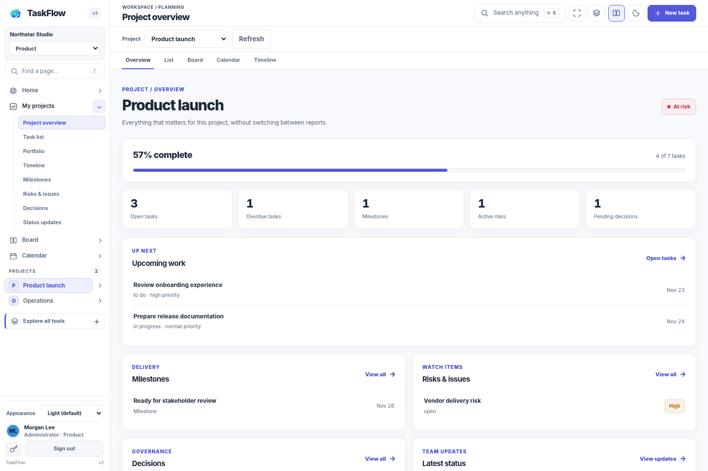](docs/screenshots/project-overview.png)<br>See progress, risks and project context. | [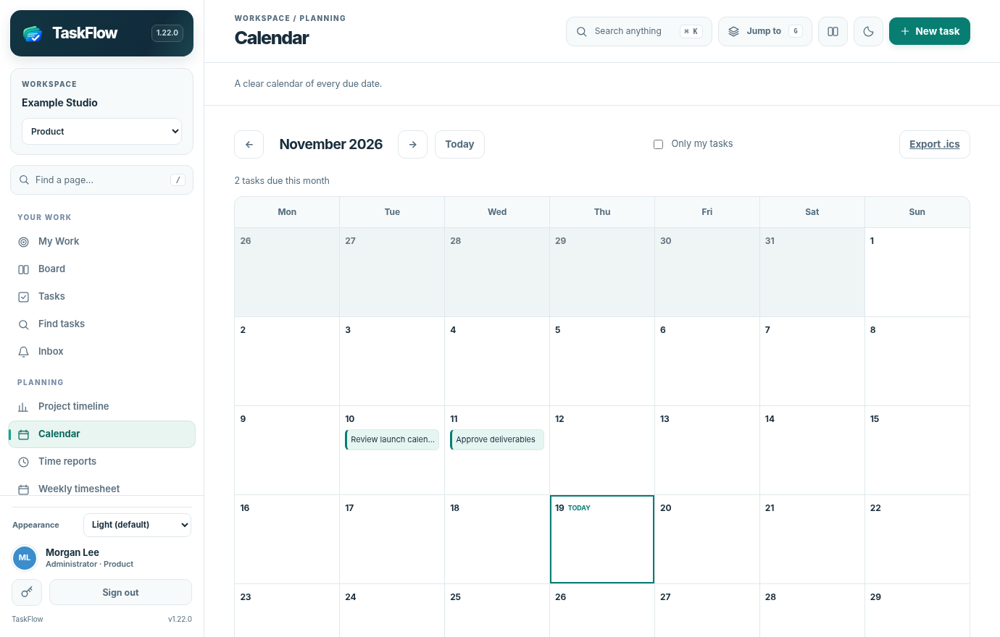](docs/screenshots/calendar.png)<br>View scheduled work and due dates. |

| Task details | Task reviews |
| :--- | :--- |
| [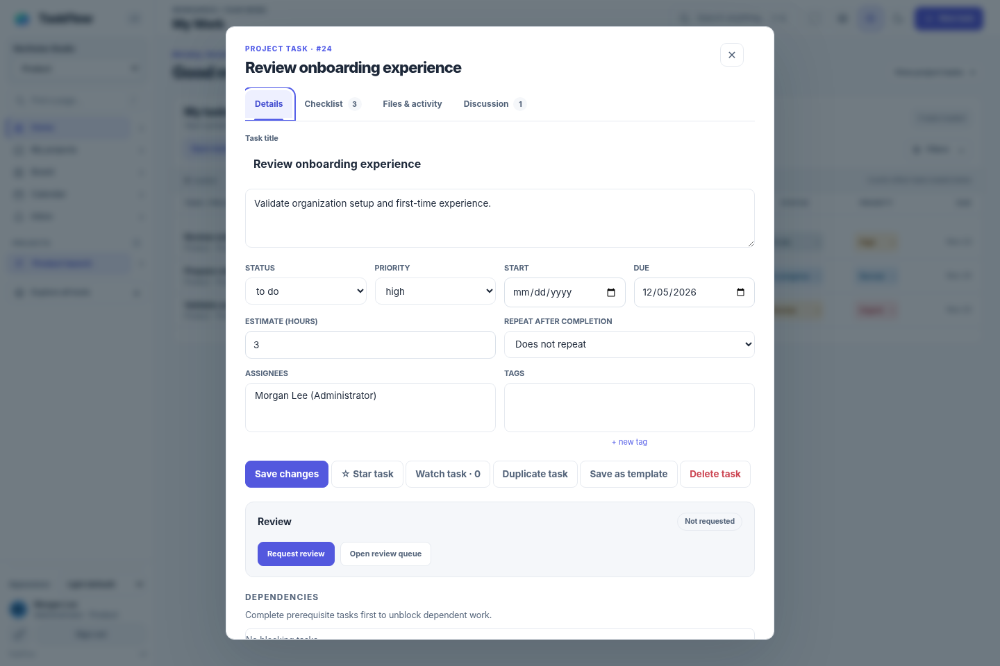](docs/screenshots/v3-task-details-light.png)<br>Review and edit the task without leaving the workspace. | [](docs/screenshots/v3-task-reviews-light.png)<br>Request feedback and manage review decisions. |

| Team chat | Workload planner |
| :--- | :--- |
| [](docs/screenshots/current-team-chat.png)<br>Discuss work in team channels. | [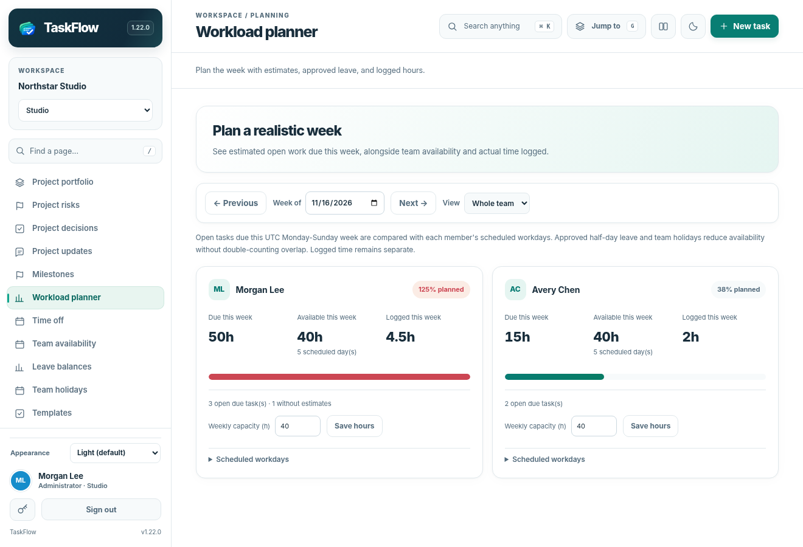](docs/screenshots/workload.png)<br>Plan team capacity. |

### Explore every workspace area

The sections below contain screenshots for all primary application destinations, along with setup, task workflows, mobile layouts, and themes. You can also browse the [complete screenshot gallery](docs/SCREENSHOTS.md) on a separate page.

<details>
<summary><strong>Work and task management (9 more screenshots)</strong></summary>

| Find tasks | Saved searches |
| :--- | :--- |
| [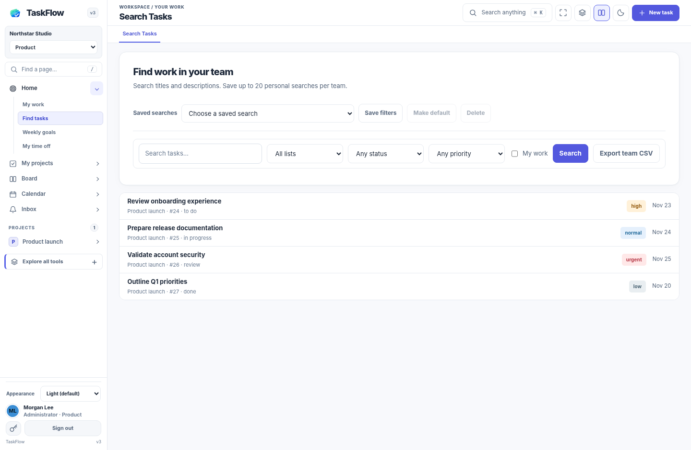](docs/screenshots/current-search.png)<br>Search and filter work across project lists. | [](docs/screenshots/saved-searches.png)<br>Reuse personal search filters. |

| Task checklists | Task attachments |
| :--- | :--- |
| [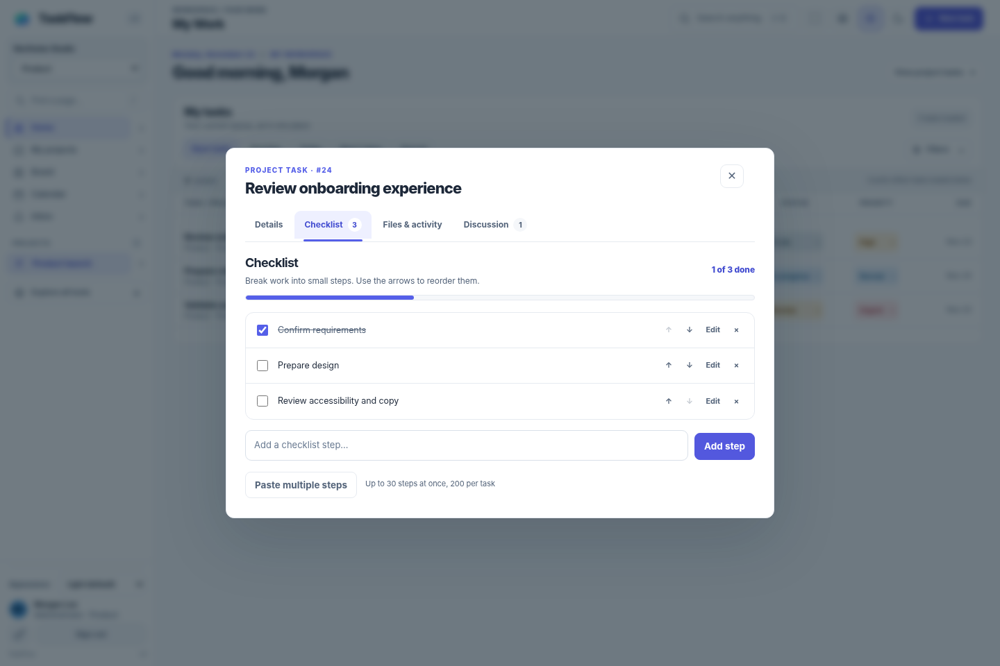](docs/screenshots/v3-task-checklist-light.png)<br>Track individual steps. | [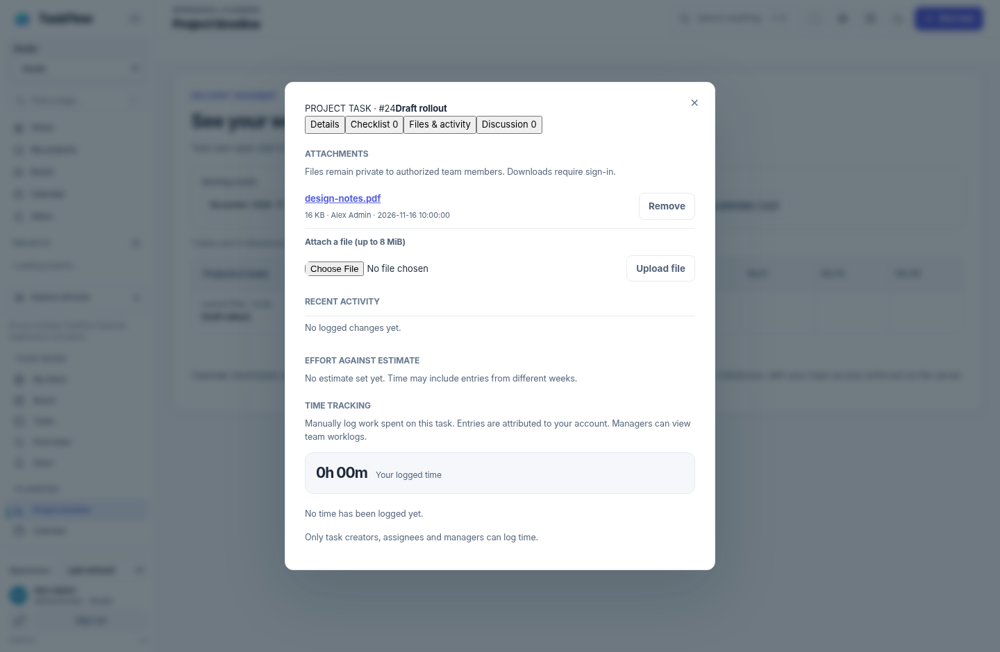](docs/screenshots/task-files.png)<br>Manage private task files. |

| Task worklog | Bulk planning |
| :--- | :--- |
| [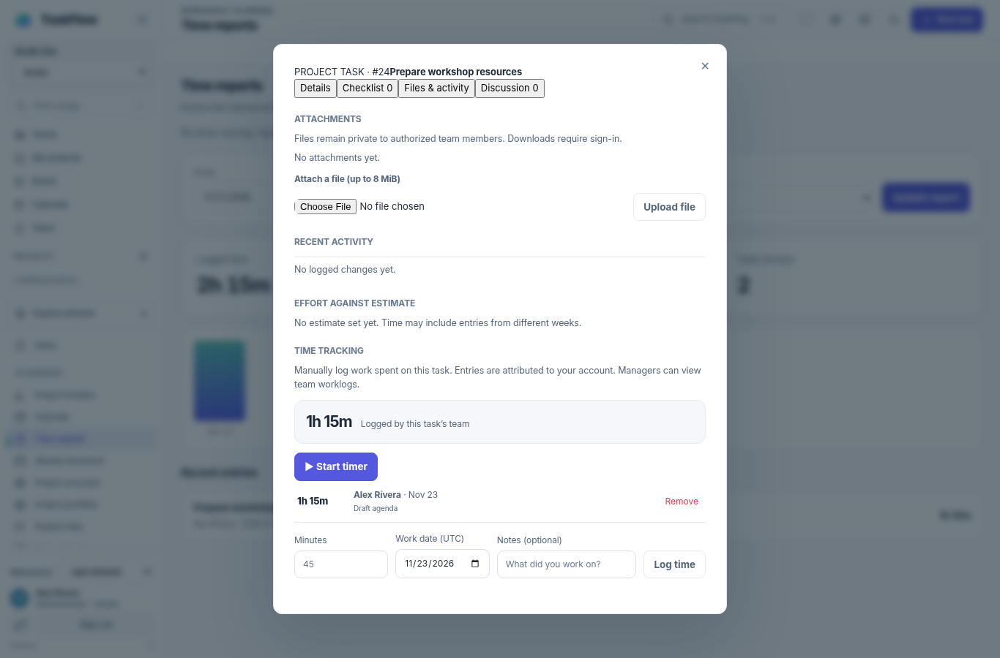](docs/screenshots/task-worklog.png)<br>Record time against a task. | [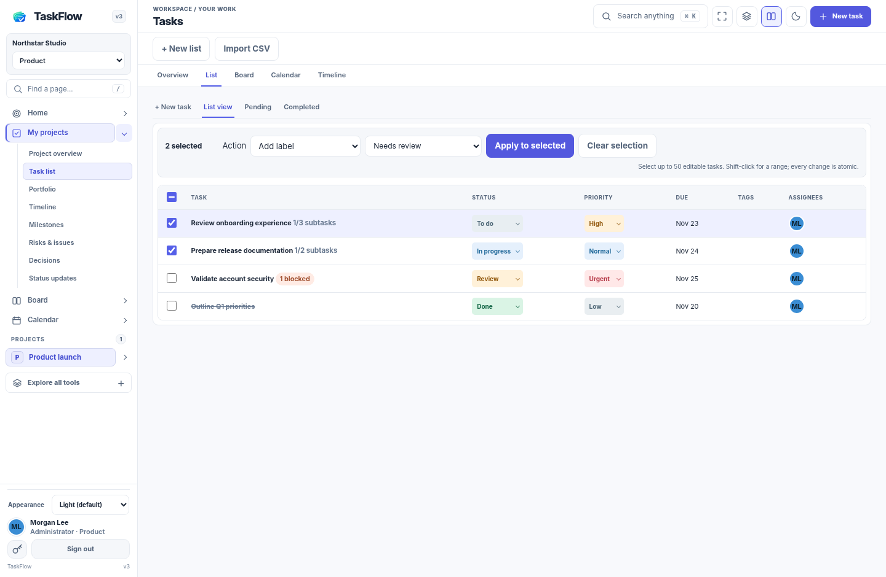](docs/screenshots/v3-bulk-planning-light.png)<br>Update selected tasks together. |

| CSV import | Task templates |
| :--- | :--- |
| [](docs/screenshots/task-csv-import.png)<br>Import tasks into a project. | [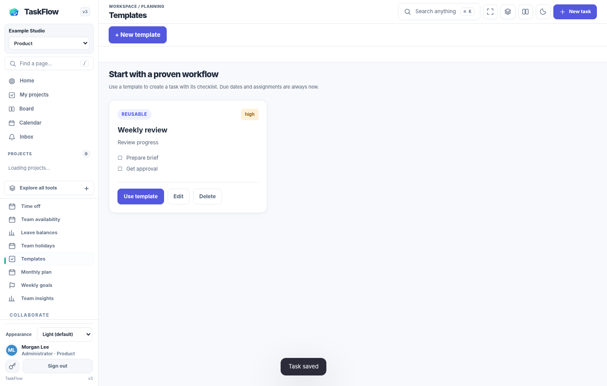](docs/screenshots/templates.png)<br>Reuse repeatable task structures. |

| Quick navigation |   |
| :--- | :--- |
| [](docs/screenshots/page-switcher.png)<br>Jump between workspace destinations. |   |

</details>

<details>
<summary><strong>Project planning and delivery (9 more screenshots)</strong></summary>

| Project portfolio | Project timeline |
| :--- | :--- |
| [](docs/screenshots/portfolio.png)<br>Compare delivery status across projects. | [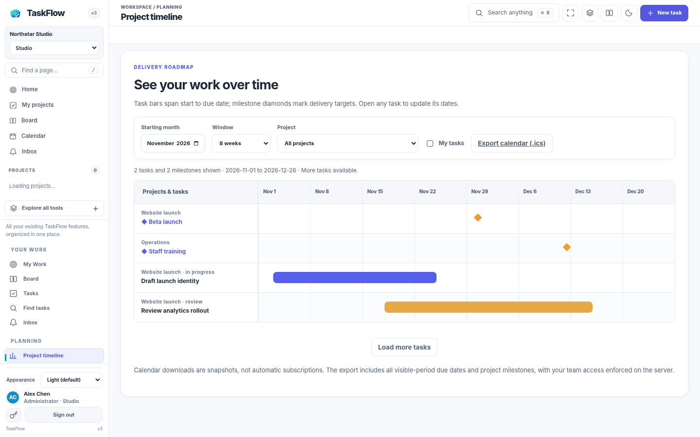](docs/screenshots/timeline.png)<br>Visualize scheduled tasks and milestones. |

| Milestones | Monthly plan |
| :--- | :--- |
| [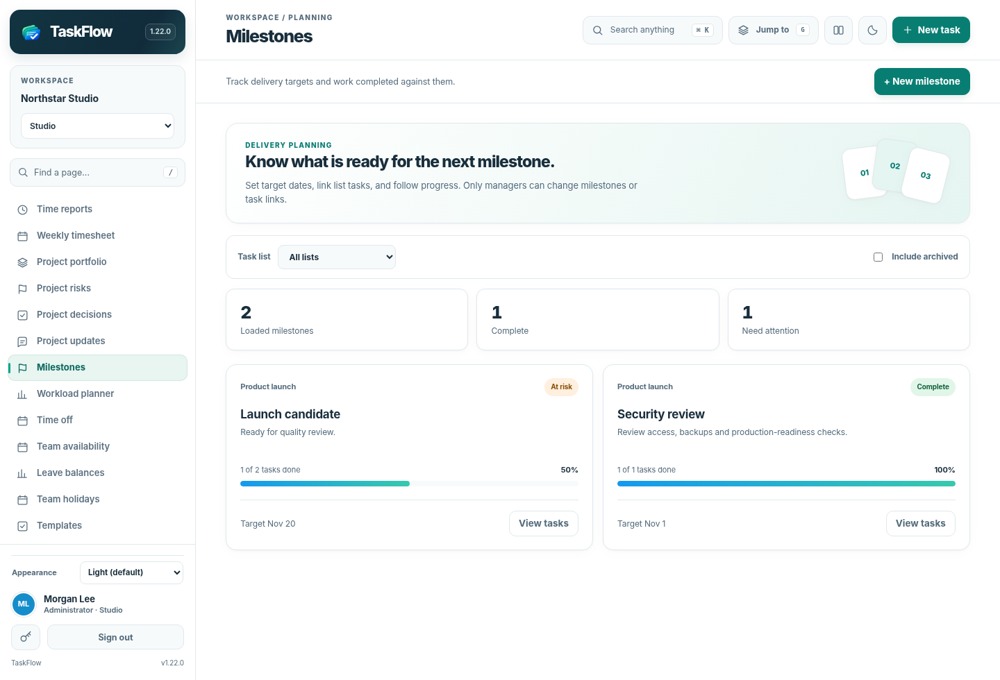](docs/screenshots/milestones.png)<br>Track key delivery targets. | [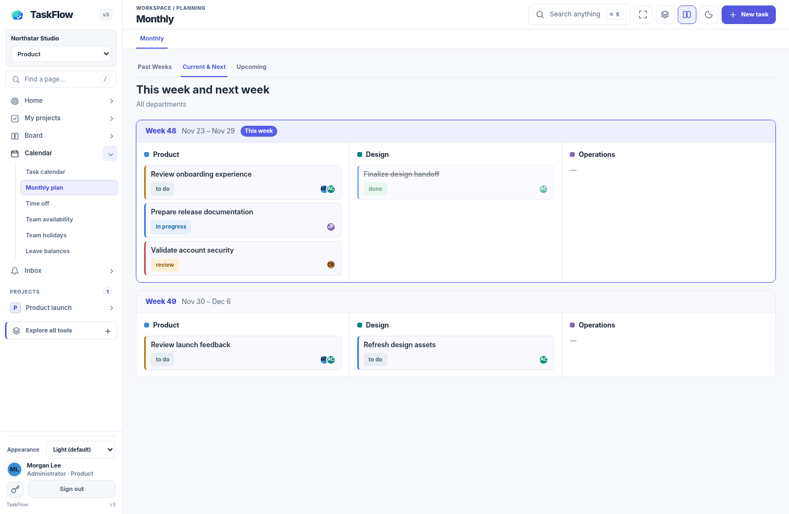](docs/screenshots/current-monthly-plan.png)<br>Review current and upcoming weeks. |

| Weekly goals | Team insights |
| :--- | :--- |
| [](docs/screenshots/current-weekly-goals.png)<br>Set individual goals and review team priorities. | [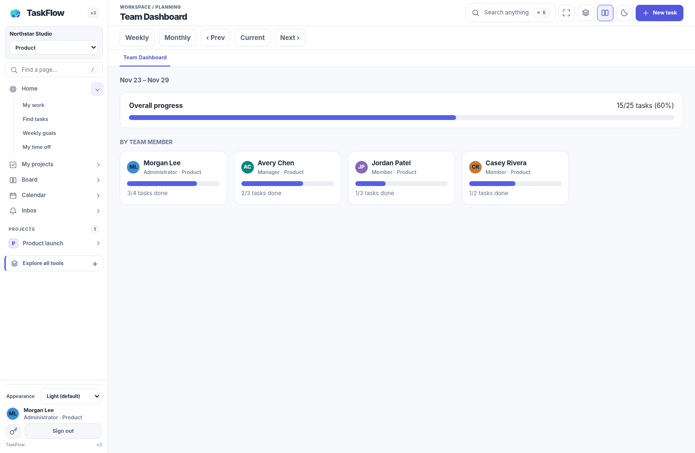](docs/screenshots/current-team-insights.png)<br>See completion progress by teammate. |

| Project risks | Project decisions |
| :--- | :--- |
| [](docs/screenshots/project-risks.png)<br>Track risks and mitigation plans. | [](docs/screenshots/project-decisions.png)<br>Record decisions and ownership. |

| Project updates |   |
| :--- | :--- |
| [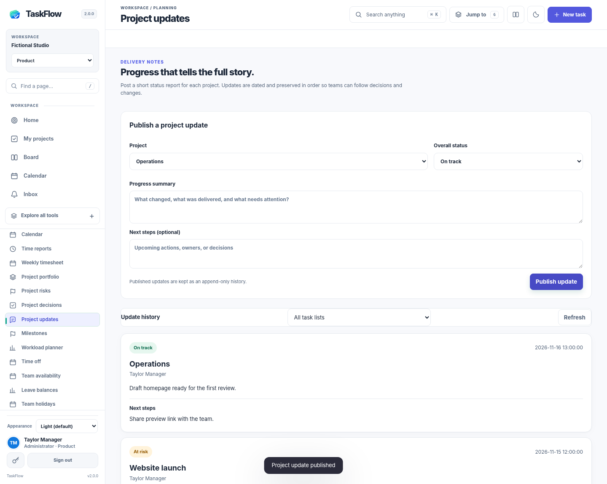](docs/screenshots/project-updates.png)<br>Share progress and next steps. |   |

</details>

<details>
<summary><strong>Communication and collaboration (6 more screenshots)</strong></summary>

| Inbox | Threaded discussions |
| :--- | :--- |
| [](docs/screenshots/v3-inbox-triage-light.png)<br>Review notifications and mark them read or unread. | [](docs/screenshots/v3-discussions-light.png)<br>Reply to task discussions and mention teammates. |

| Team announcements | Direct messages |
| :--- | :--- |
| [](docs/screenshots/announcements.png)<br>Publish notices and collect acknowledgments. | [](docs/screenshots/current-direct-messages.png)<br>Have one-to-one conversations. |

| People | Team activity |
| :--- | :--- |
| [](docs/screenshots/current-people.png)<br>View the team directory. | [](docs/screenshots/current-team-activity.png)<br>Review changes and activity history. |

</details>

<details>
<summary><strong>Time and team capacity (8 more screenshots)</strong></summary>

| Time reports | Weekly timesheet |
| :--- | :--- |
| [](docs/screenshots/time-reports.png)<br>Review logged hours. | [](docs/screenshots/timesheet.png)<br>Track and submit time by week. |

| Timesheet approvals | Time off |
| :--- | :--- |
| [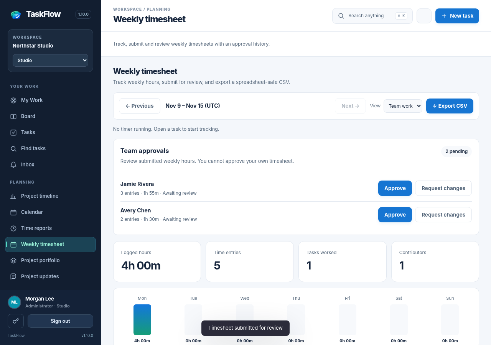](docs/screenshots/approvals.png)<br>Review submitted timesheets. | [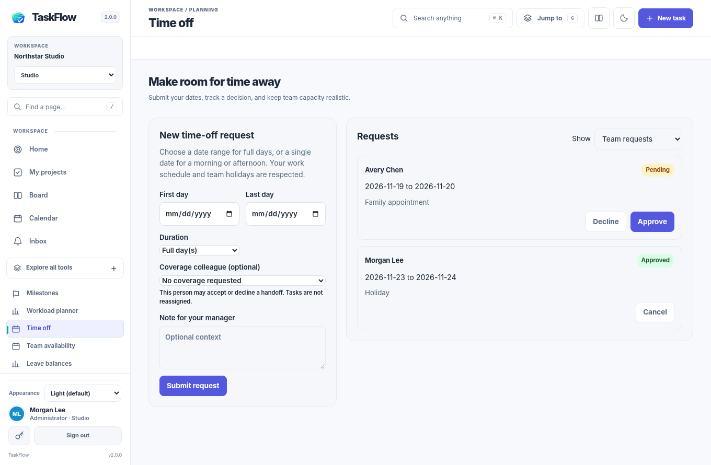](docs/screenshots/time-off.png)<br>Request leave and review requests. |

| Team availability | Leave balances |
| :--- | :--- |
| [](docs/screenshots/availability.png)<br>Review absences on the team calendar. | [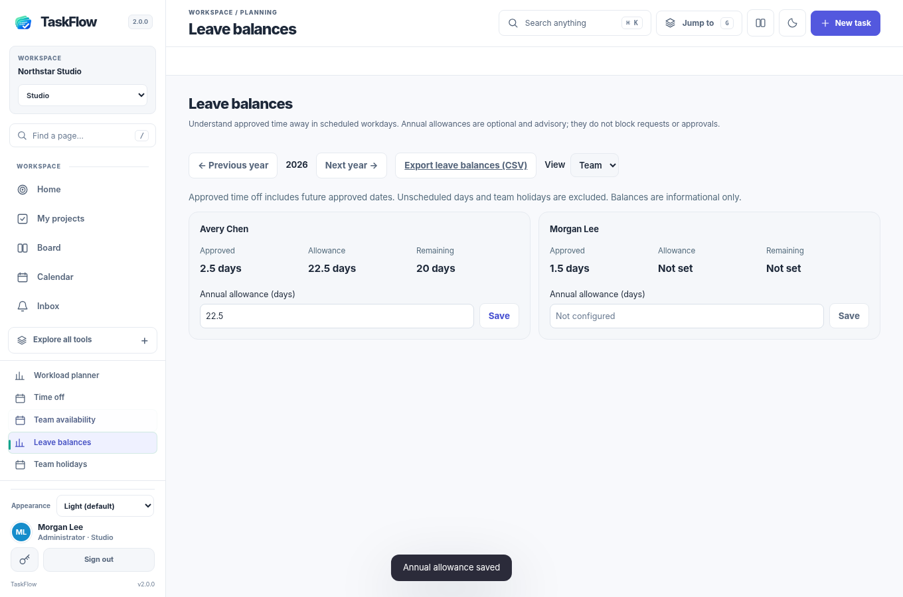](docs/screenshots/leave-balances.png)<br>View annual leave allowances and balances. |

| Team holidays | Coverage |
| :--- | :--- |
| [](docs/screenshots/holidays.png)<br>Maintain the shared holiday calendar. | [](docs/screenshots/coverage.png)<br>Review team coverage alongside leave. |

</details>

<details>
<summary><strong>Organization and administration (8 more screenshots)</strong></summary>

| Organization overview | Teams |
| :--- | :--- |
| [](docs/screenshots/current-organization-overview.png)<br>View overall and per-team progress. | [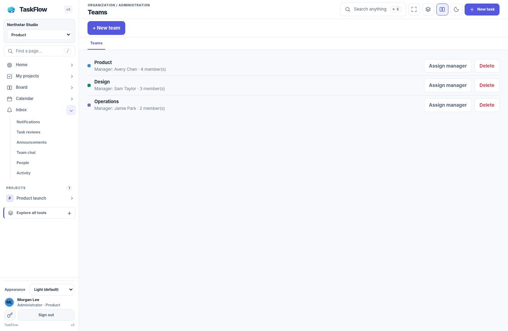](docs/screenshots/current-teams.png)<br>Manage teams and their managers. |

| Accounts | Invitations |
| :--- | :--- |
| [](docs/screenshots/current-accounts.png)<br>Manage user roles and account status. | [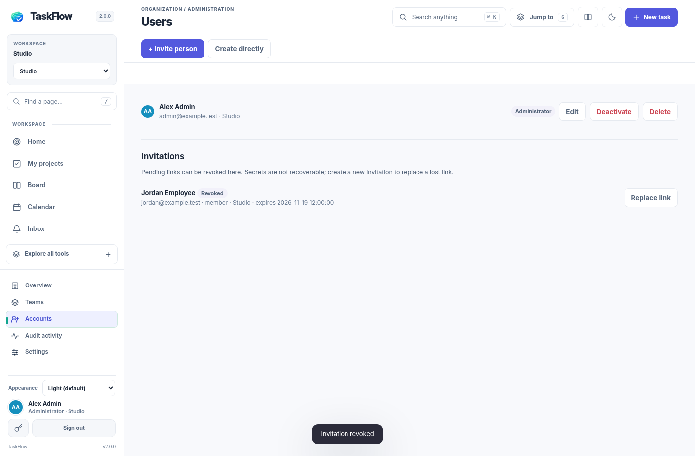](docs/screenshots/invitations.png)<br>Review account invitations. |

| Organization audit | Organization settings |
| :--- | :--- |
| [](docs/screenshots/current-organization-audit.png)<br>Filter and export organization activity. | [](docs/screenshots/current-settings.png)<br>Configure organization and mail preferences. |

| My account | Account security |
| :--- | :--- |
| [](docs/screenshots/current-my-account.png)<br>Manage personal email and notification preferences. | [](docs/screenshots/current-account-security.png)<br>Manage MFA and remembered sessions. |

</details>

<details>
<summary><strong>Installation and access (4 more screenshots)</strong></summary>

| First-time setup | Sign in |
| :--- | :--- |
| [](docs/screenshots/setup.png)<br>Configure a new TaskFlow installation. | [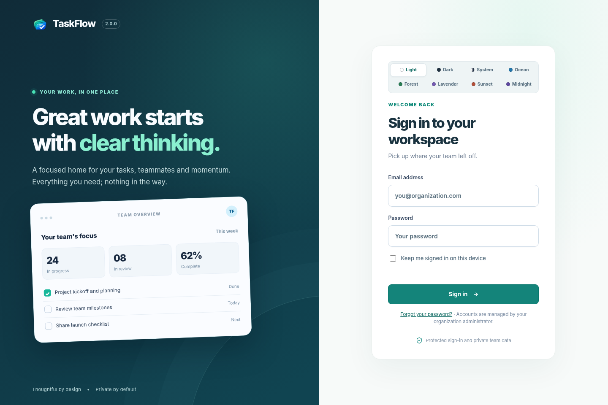](docs/screenshots/sign-in.png)<br>Access an existing workspace. |

| Accept invitation | Password recovery |
| :--- | :--- |
| [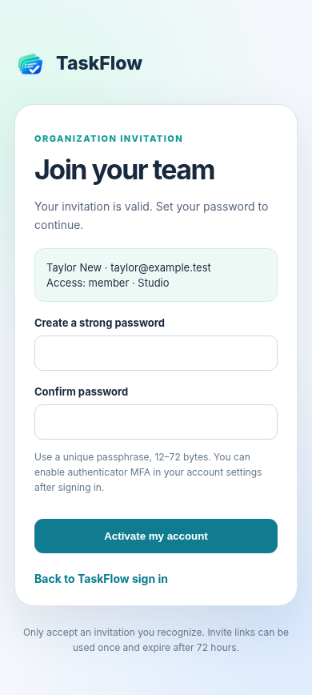](docs/screenshots/invite-accept.png)<br>Join an organization through an invitation. | [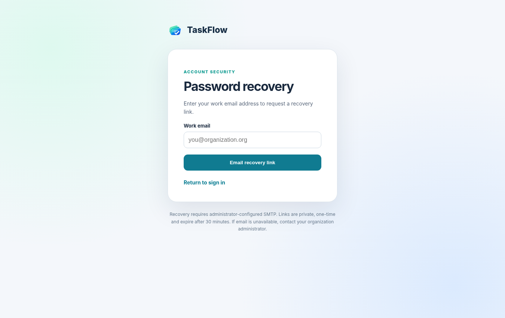](docs/screenshots/password-recovery.png)<br>Recover access to an existing account. |

</details>

<details>
<summary><strong>Appearance and mobile (8 more screenshots)</strong></summary>

| Charcoal | Black / OLED |
| :--- | :--- |
| [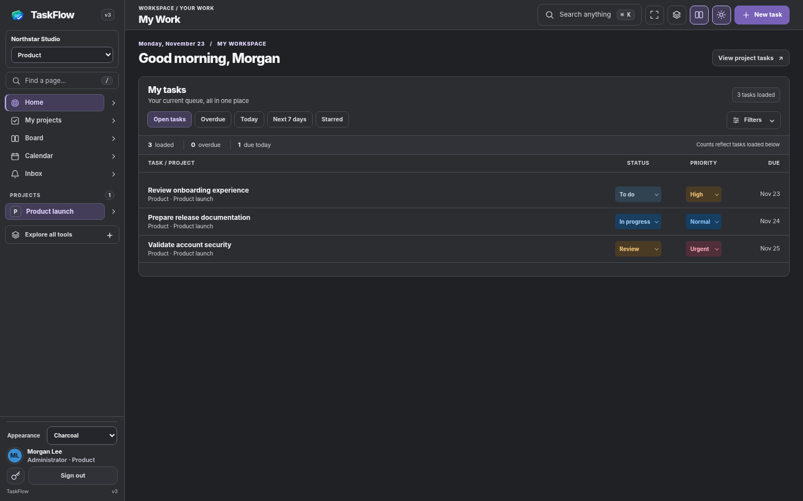](docs/screenshots/v3-compact-charcoal-home.png)<br>Compact workspace in Charcoal. | [](docs/screenshots/v3-compact-black-home.png)<br>Compact workspace in Black. |

| Additional color palettes | Mobile workspace |
| :--- | :--- |
| [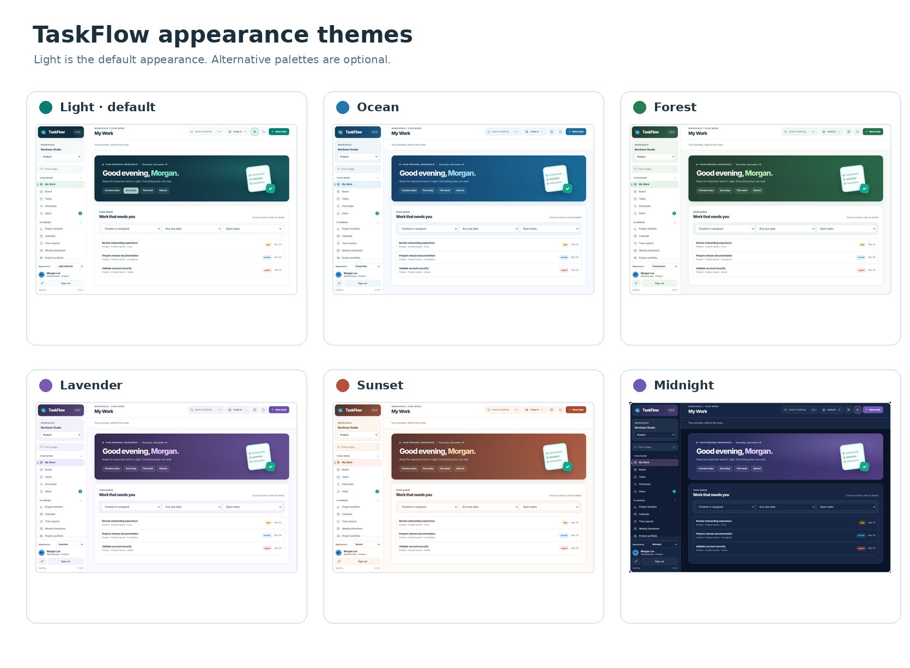](docs/screenshots/theme-collection.png)<br>Examples of the other appearance options. | [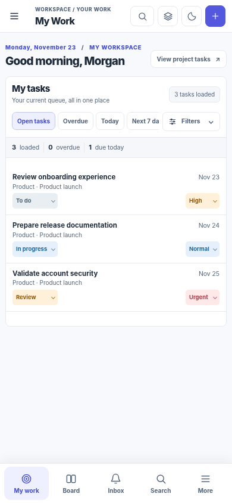](docs/screenshots/v3-compact-mobile-home.png)<br>My Work on a narrow screen. |

| Mobile navigation | Mobile task details |
| :--- | :--- |
| [](docs/screenshots/v3-submenus-mobile.png)<br>Nested navigation on mobile. | [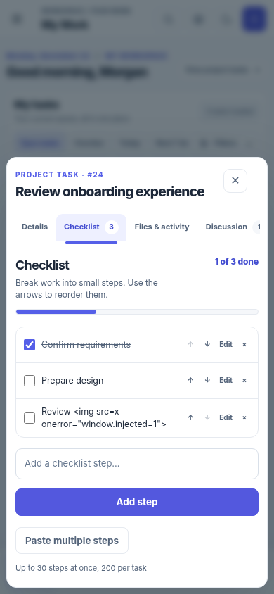](docs/screenshots/v3-task-checklist-mobile.png)<br>Task checklist on a phone. |

| Mobile discussions | Mobile task reviews |
| :--- | :--- |
| [](docs/screenshots/v3-discussions-mobile.png)<br>Threaded discussion on mobile. | [](docs/screenshots/v3-task-reviews-mobile.png)<br>Review queue on mobile. |

</details>

> Screenshots show the application UI using illustrative sample organizations, accounts and tasks. The collection includes previously supplied captures and additional captures from the cleaned v3 source with simulated API responses; it is not a live hosted demo. Light is the default appearance.

## Installation

### Requirements

- PHP 8.3 or newer with `pdo_mysql`, `mbstring`, `openssl`, `sodium`, and `fileinfo`.
- MySQL 8 or newer with InnoDB; Apache or Nginx with PHP-FPM.
- A dedicated database, a dedicated hostname, and HTTPS for a hosted workspace.
- Private storage and a local ClamAV daemon if you enable task attachments.

No Node.js, Composer, or JavaScript build step is needed to run the application.

### Quick start

1. Download or clone the repository:

   ```bash
   git clone https://github.com/sameerahmedco/TaskFlow.git
   cd TaskFlow
   ```

2. Create a new, empty MySQL database and dedicated database user. Do not import `schema.sql` manually when using the installer.
3. Copy the application to your configured web root. Enable HTTPS and the private-path protections described in the [deployment guide](docs/DEPLOYMENT.md). The PHP worker needs temporary write access to `config/` during setup.
4. From the application directory, generate a one-time setup key as the PHP service account (replace `www-data` if necessary):

   ```bash
   sudo -u www-data php bin/setup-key.php
   ```

5. Visit `https://your-domain/install/`, enter the setup key and database details, and create your organization and first administrator. The wizard creates the schema and locks installation.
6. Sign in, enable administrator MFA, preserve the private configuration and installation lock, and verify your installation with the [deployment checklist](docs/DEPLOYMENT.md#before-opening-public-access).


**Already using TaskFlow?** Do not run the installer or fresh schema on an existing database. Back up your data, private files, application key and configuration, then apply only missing migrations according to the [upgrade guide](docs/UPGRADE.md).

The included Dockerfile is an optional PHP/Apache starting point. It requires a separate MySQL server, private persistent configuration, and a trusted TLS edge; see the deployment guide.

## Documentation

| Guide | Description |
| :--- | :--- |
| [Screenshot gallery](docs/SCREENSHOTS.md) | Full visual tour of the application |
| [Features](docs/FEATURES.md) | Product capabilities and available views |
| [Deployment](docs/DEPLOYMENT.md) | Setup, server configuration, attachments, scheduled jobs and verification |
| [Upgrade](docs/UPGRADE.md) | Database migration and backup instructions |
| [Administrator MFA](docs/ADMIN-MFA.md) | Account security configuration |
| [Security](SECURITY.md) | Security model and vulnerability reporting guidance |
| [Release notes](CHANGELOG.md) | What is included in TaskFlow v3 |

## Support and security

Use [GitHub Issues](https://github.com/sameerahmedco/TaskFlow/issues) for non-sensitive bug reports. Do not post passwords, configuration files, tokens, or private organizational data. For vulnerabilities, follow the [security policy](SECURITY.md).

TaskFlow v3 is a feature-frozen source distribution. The repository does not include development tests or internal QA reports. Public source availability does not certify a production installation; validate your actual MySQL, HTTPS, backups, permissions, and attachment scanning before hosting it for real users.

## License

No source license has been supplied by the maintainer. Publicly visible source code is not a grant of open-source or redistribution rights. Refer to the repository owner for licensing and usage permission.
