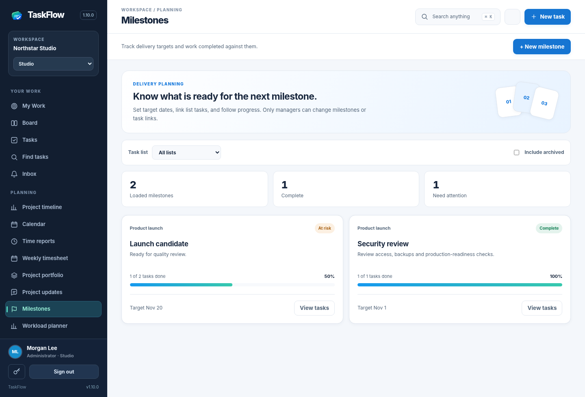
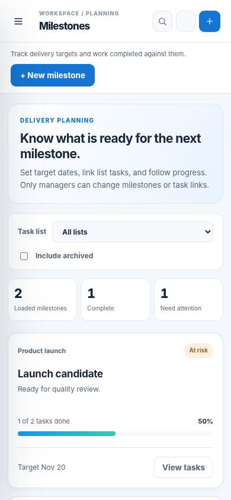

# TaskFlow 1.6.0 - Delivery milestones

**Release date:** November 15, 2026. **Status:** Staging / release candidate pending database-backed and security testing.

TaskFlow 1.6.0 introduces milestones while preserving the existing lightweight PHP/MySQL architecture, organization installer, MFA, time tracking, timesheet reviews and workload planning. The public product name is **TaskFlow**.

## What's new

- **Milestone planning:** create delivery targets for existing task lists with an optional target date and description, and archive completed phases.
- **Linked task progress:** attach task records from the milestone's own list; each task can be assigned to one milestone at a time. Completion percent is derived from linked tasks with `status = done`.
- **Deadline signals:** highlight an incomplete milestone when its target is past due, when it is within seven days, or when a linked unfinished task is already overdue.
- **Progress detail:** view linked tasks, open the task details, and unlink records without deleting them. Show a milestone link in task detail.
- **Permissions and performance:** managers/administrators manage milestones, members have read-only access. List/team validation and CSRF protect changes, link operations use transactions and row locks, and result pages are bounded at 20 milestones / 40 linked tasks.
- **Updated source:** navigation, responsive designs, docs, schema, migration, tests and source security assertions.

| Desktop | Mobile |
| --- | --- |
|  |  |

Screenshots use fictional sample records and mocked APIs, not any organization's real data.

## Upgrade from 1.5.0

1. Back up the database and private configuration, and prove a staging restore.
2. Pause writers and apply `docs/migrations/1.6.0.sql` **once** to the existing 1.5.0 database. It adds `milestones` and `milestone_tasks`. It does not migrate or rewrite existing tasks, worklogs, estimates or approvals.
3. Deploy new source files without overwriting `config/config.local.php`, your application key or `config/.installed`. Do not run the fresh organization installer or import `schema.sql` into the existing database.
4. Verify manager/member permissions, same-list task linking, archive/restore, task deletion cleanup, date boundaries, and existing workload/time approval workflows against MySQL 8.

For older installations, apply missing migrations **in order** through 1.6.0. The DDL is not generally safe to re-run. See [UPGRADE.md](UPGRADE.md).

## Limitations and verification

- Milestones are scoped to task lists, not a separate cross-list project hierarchy. A task may belong to one milestone, and recurring successor tasks are **not** automatically assigned to the original milestone.
- A milestone with no linked tasks shows 0% progress. Archiving is a visibility setting, not a task lock. Managers can still edit tasks separately.
- Completion/risk information is calculated from task status and due dates, not from objective quality or financial acceptance gates.
- The new milestone browser suite uses mocked API responses. PHP unit and source checks cannot replace live MySQL 8 integration, adversarial access-control tests, concurrency testing, restore drills or performance benchmarks. The GitHub MySQL integration workflow includes additional milestone SQL checks but has not been executed here.
- No frontend framework, cloud service, persistent background daemon, or new secret-setting requirement has been added.
