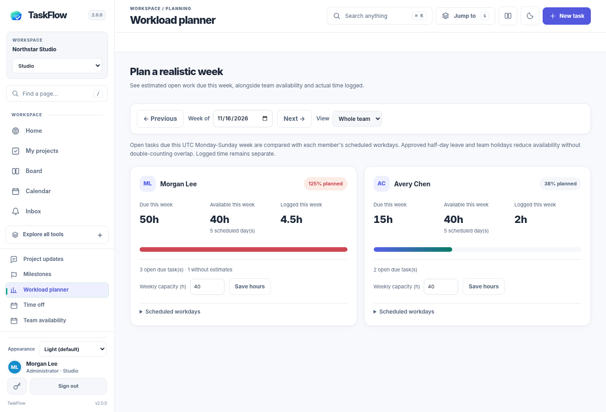
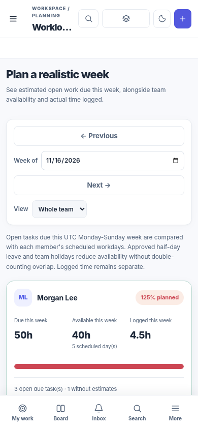

# TaskFlow 1.5.0 — Effort and workload planning

This release adds a planning layer on top of TaskFlow's existing tasks, time entries and weekly approval workflows. The product name remains **TaskFlow**.

## New features

1. **Task effort estimates.** Add optional planned effort in hours when creating or editing a task. Team-authorized users can compare total logged minutes with the estimate in the task detail. The server limits estimates to 1–24,000 minutes (400 hours); a blank value means *not estimated*.
2. **Weekly workload planner.** Open **Planning → Workload planner** to see assigned open tasks due during a selected UTC Monday–Sunday week. Each assignee's full estimate is included, and tasks without estimates are counted separately. A due-week estimate is a forecast, not a daily schedule.
3. **Weekly availability.** The default is 40 hours per active team member; each member may edit their own availability and authorized managers/administrators may edit their team's entries (0–80 hours). A bar flags work over capacity; logged time remains a separate metric.
4. **Preserved estimates.** Duplicated and weekly-recurring tasks copy estimates. Reusable task templates can store them, too. No new frontend framework, server daemon or SaaS dependency is required.

| Desktop workload planning | Phone layout |
| --- | --- |
|  |  |

## Safety and limits

- All access is authenticated and team checked. Only managers/administrators can view a whole team's workload, while members see their own rows. A capacity update is permitted only for the member themself or an authorized manager, after a current-team membership check; write operations enforce CSRF tokens.
- SQL queries restrict estimates to unfinished tasks with a due date in the selected week, and time entries to their **current task team**, avoiding cross-team historical leakage. Each response contains at most 100 people. Weeks are limited to 52 weeks before/after the current UTC week.
- Multiple assignees each receive the task's full estimate in their personal plan. Estimates are **not automatically divided** by the number of assignees, and planned effort is **not** subtracted from logged time. Unassigned, completed, undated and unestimated tasks do not contribute planned minutes. Unestimated assigned/due tasks are shown as a warning count.
- Workload planning does not change approved timesheets, hourly pay or verified billing records. No forecasting algorithm or automatic workload balancing is claimed.

## Upgrade from 1.4.0

1. Back up your MySQL database, private config and encryption key; test a restore on staging.
2. Stop writes. Apply `docs/migrations/1.5.0.sql` **once** to the 1.4.0 schema. It adds nullable `tasks.estimate_minutes`, nullable `task_templates.estimate_minutes`, a user-capacity table, indexes and constraints. It does not rewrite existing worklogs or approvals.
3. Deploy the updated source, preserving `config/config.local.php` and `config/.installed`. **Do not** run the fresh installer or import `schema.sql` over an existing database.
4. Test a manager/member cross-team authorization matrix, task estimate and recurring/template copy, personal capacity edit, workload view, login/MFA, and timesheet approvals against MySQL 8.

## Verification status

PHP/JS lint, isolated validation tests, static source checks and mocked Chromium UI regressions run locally. The live MySQL integration workflow is included but has **not** been executed successfully in this environment. Complete MySQL integration, concurrency/security testing and performance benchmarks before a public production deployment. See [`TEST-RESULTS.md`](../../TEST-RESULTS.md).
